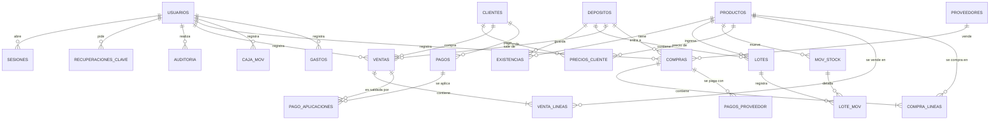

<!-- Documento generado uniendo docs/tfi/carpeta/01..12. Para modificarlo, editar las secciones y volver a unirlas. -->

# Universidad Tecnológica Nacional – Facultad Regional Tucumán

## Tecnicatura Universitaria en Programación

# Trabajo Final Integrador

# Gestión para Distribuidoras/Negocios
### Sistema de gestión de stock, ventas, deudas y caja para una distribuidora de cigarrillos

| | |
|---|---|
| **Institución / empresa vinculante** | Gestión de Negocio de Cigarrillos |
| **Integrantes** | Juan Pablo Romagnoli – Legajo [COMPLETAR] · Guillermo Jiménez – Legajo [COMPLETAR] |
| **Carrera** | Tecnicatura Universitaria en Programación (TUP) – Plan 2024 |
| **Materia** | Metodología de Sistemas II |
| **Tutora académica / Docente** | Ing. Rosana Soledad Marchese |
| **Repositorio del proyecto** | https://github.com/juanpablordm11-dot/tfi-gestion-distribuidora |
| **Fecha de presentación** | 27/11/2026 |

*(Logotipo UTN-FRT)*

---

# 2. ÍNDICE

1. Portada
2. Índice
3. Resumen ejecutivo
4. Introducción
5. Estado del arte
6. Descripción del proyecto
   - 6.1 Problemática detectada · 6.2 Solución propuesta · 6.3 Alcance · 6.4 Usuarios y roles · 6.5 Historias de usuario · 6.6 Reglas de negocio · 6.7 Requisitos · 6.8 Matriz de trazabilidad · 6.9 Restricciones, limitaciones y suposiciones · 6.10 Diagrama entidad–relación y normalización · 6.11 Propuesta de mejora y presupuesto · 6.12 Mejoras a futuro · 6.13 Atributos de calidad · 6.14 Criterios de aceptación
7. Metodología
8. Recursos necesarios
9. Plan de trabajo
10. Resultados esperados
11. Referencias
12. Anexos
   - A. Relevamiento de requerimientos · B. Diccionario de datos · C. Pruebas automáticas · D. Patrón de diseño (TP 2) · E. Repositorio y ejecución · F. Glosario · G. Diagrama causa–efecto · H. Cumplimiento de los requisitos de la cátedra · I. Control de versiones

Documento anexo aparte: **Manual de usuario**.

*(En Google Docs, reemplazar esta lista por un índice automático con números de página: Insertar → Índice.)*

---

# 3. RESUMEN EJECUTIVO

## 3.1 Breve descripción del proyecto
El proyecto consiste en el desarrollo de **Gestión para Distribuidoras/Negocios**, una aplicación web cliente–servidor para una distribuidora mayorista de cigarrillos que vende a comercios (kioscos, almacenes, autoservicios) y guarda su mercadería en dos depósitos. El sistema reemplaza el registro manual y centraliza el stock por depósito, los precios especiales por cliente, las ventas al contado y fiadas, las deudas con cobros parciales, las compras a proveedores, la caja, los gastos y el cálculo de ganancias.

## 3.2 Objetivos principales
- Conocer en todo momento el stock exacto de cada depósito.
- Cobrar a cada cliente el precio acordado y controlar su crédito.
- Saber cuánto debe cada cliente, con pagos parciales y vencimientos.
- Calcular la ganancia real de cada venta con el costo del momento.
- Ordenar la caja y dejar registrada cada operación y quién la hizo.

## 3.3 Metodología utilizada
Se trabajó con un enfoque **ágil, iterativo e incremental inspirado en Scrum**, en tres sprints: los dos primeros (15/09/2026 – 23/11/2026) construyeron el sistema para el cliente, y el tercero (desde el 25/11/2026) lo adecuó a los requisitos del TFI, incorporó las correcciones de la docente y completó la documentación. El sistema se construyó con Node.js, SQLite y JavaScript sin dependencias externas, con arquitectura en capas y pruebas automáticas de punta a punta.

## 3.4 Resultados obtenidos y esperados
- Sistema web funcional con **58 pruebas automáticas** que verifican las reglas de negocio, la seguridad y la integridad contable.
- Login, recuperación de contraseña y **roles diferenciados** (Administrador y Empleado), con el control de permisos en el servidor.
- Base de datos relacional normalizada (3FN) con claves primarias y foráneas, restricciones y registros que no se borran (se anulan con motivo).
- Reportes en pantalla con **filtros** y **exportación a CSV**, y comprobante de venta en PDF.
- Aplicación del patrón de diseño **Strategy** (TP 2 de la materia) en el envío del código de recuperación.
- Mejora propuesta y presupuestada: exportación a PDF de los reportes.

## 3.5 Conclusiones generales
El proyecto integró los contenidos de la carrera (programación, bases de datos, metodología de sistemas, seguridad y patrones de diseño) en un sistema real que resuelve problemas concretos de un negocio. El trabajo con el cliente y luego con la cátedra mostró la importancia de relevar bien las reglas del negocio, documentar las decisiones y verificar cada cambio con pruebas antes de darlo por terminado.

---

# 4. INTRODUCCIÓN

## 4.1 Contexto y antecedentes
Las distribuidoras mayoristas pequeñas trabajan con márgenes ajustados, muchos clientes recurrentes y una alta rotación de mercadería. En el rubro de los cigarrillos, además, los precios cambian con frecuencia, cada comercio negocia su propio precio y una parte importante de las ventas se hace "fiado", con pagos parciales.

El cliente, **Gestión de Negocio de Cigarrillos**, llevaba su negocio con anotaciones manuales. La mercadería está repartida en dos depósitos (galpón y casa), y la información de stock, precios, deudas y caja estaba dispersa. A partir del relevamiento de esa situación, el equipo desarrolló un sistema a medida entre septiembre y noviembre de 2026, que luego se retomó y amplió como Trabajo Final Integrador, como admite la cátedra para proyectos previos, que pueden ser "retomados, ampliados, mejorados o reformulados" (UTN FRT, 2026b).

## 4.2 Justificación y relevancia
- **Para el negocio:** errores en el stock, en el precio cobrado o en la deuda de un cliente se traducen en pérdida de dinero y de confianza. Un sistema que calcule esos valores de forma exacta y deje registro de cada operación reduce esos errores.
- **Para la formación:** el proyecto obliga a aplicar de manera integrada el análisis de requisitos, el modelado de datos y su normalización, la arquitectura en capas, la seguridad (autenticación, roles, contraseñas), las pruebas automáticas, los patrones de diseño y la gestión de un proyecto con un cliente real.

## 4.3 Objetivo general
Desarrollar un sistema web de gestión para una distribuidora de cigarrillos que centralice el stock en dos depósitos, los precios por cliente, las ventas, las deudas con cobros parciales, las compras, la caja y las ganancias, garantizando la exactitud de los datos y la trazabilidad de las operaciones.

## 4.4 Objetivos específicos
1. Relevar los procesos del negocio y especificar requisitos, reglas de negocio e historias de usuario.
2. Diseñar una base de datos relacional normalizada hasta la tercera forma normal.
3. Implementar autenticación, recuperación de contraseña y control de acceso por roles (Administrador y Empleado).
4. Implementar el ABM y la consulta de productos, clientes, proveedores y usuarios.
5. Registrar ventas, cobros, compras y movimientos de stock y caja sin borrar información (anulaciones con motivo).
6. Brindar reportes en pantalla con filtros y exportación de datos.
7. Verificar el comportamiento del sistema con pruebas automáticas.
8. Aplicar un patrón de diseño a un problema real del sistema y justificar su elección.
9. Proponer y presupuestar una mejora concreta.

---

# 5. ESTADO DEL ARTE

## 5.1 Contexto tecnológico actual
La gestión de pequeños comercios y distribuidoras se resuelve hoy de tres maneras: registros manuales (cuaderno o planillas de cálculo), sistemas de gestión comerciales genéricos (de escritorio o en la nube, por suscripción) y desarrollos a medida. Las aplicaciones web se volvieron el enfoque predominante porque se usan desde cualquier dispositivo con un navegador y centralizan la información en un servidor.

## 5.2 Soluciones existentes y comparativa

| Criterio | Cuaderno / planilla | Sistema comercial genérico | **Gestión para Distribuidoras/Negocios** |
|---|---|---|---|
| Costo | Muy bajo | Suscripción mensual o licencia | Desarrollo propio, sin licencias |
| Stock por depósito (galpón y casa) | Manual, propenso a errores | Según el producto y el plan | **Sí**, con transferencias y lotes por fecha de ingreso |
| Precio propio por cliente | Manual | Generalmente por listas de precios | **Sí**, por producto y por cliente, por caja y por unidad |
| Fiado con pagos parciales | Difícil de seguir | Cuenta corriente genérica | **Sí**: deuda calculada, pagos aplicados a ventas, saldo a favor, límite de crédito |
| Ganancia real por venta | No | Variable | **Sí**, con costo promedio ponderado del momento |
| Trazabilidad (nada se borra) | No | Variable | **Sí**: anulaciones con motivo y auditoría |
| Adaptación a reglas del negocio | Total, pero sin control | Limitada | **Total** |
| Facturación fiscal (ARCA/AFIP) | No | Sí, en general | **No** (fuera del alcance) |

## 5.3 Enfoques tecnológicos
- **Aplicaciones de escritorio:** funcionan sin conexión, pero se instalan en cada equipo y no se acceden desde el celular.
- **Software como servicio (SaaS):** acceso desde cualquier lugar y mantenimiento tercerizado, con costo recurrente y poca personalización.
- **Aplicación web propia con arquitectura en capas:** el enfoque elegido. Combina acceso desde la PC y el celular con control total de las reglas del negocio y del código.

## 5.4 Modelado de datos y normalización
Las bases de datos relacionales siguen siendo el estándar para sistemas transaccionales porque garantizan integridad referencial y consistencia (Elmasri y Navathe, 2016; Silberschatz et al., 2019). La normalización hasta la tercera forma normal evita redundancias y anomalías de inserción, actualización y borrado. En este proyecto, además, los datos que se guardan calculados (precio y costo de cada venta) se justifican como **fotos históricas**, y la deuda no se guarda: se calcula.

## 5.5 Seguridad y control de acceso
Para aplicaciones web se recomienda guardar las contraseñas con funciones de derivación de clave lentas y con sal, como scrypt, y no en texto plano (OWASP Foundation, s.f.). Se recomienda también limitar los intentos de inicio de sesión, usar cookies de sesión HttpOnly y aplicar control de acceso por roles con el principio de mínimo privilegio. El sistema aplica estas prácticas, y el control de permisos se hace en el servidor.

## 5.6 Patrones de diseño
Los patrones de diseño son soluciones reutilizables a problemas de diseño recurrentes (Gamma et al., 1994), organizados en tres familias: creacionales, estructurales y de comportamiento. Su uso tiene que responder a un problema real, para no caer en sobreingeniería. En el proyecto se aplicó el patrón **Strategy** al envío del código de recuperación de contraseña (ver sección 7.4).

## 5.7 Aporte del proyecto
Frente a las alternativas, el sistema aporta una solución **adaptada a las reglas reales de una distribuidora**: dos depósitos, precios negociados por cliente, ventas fiadas con pagos parciales y ganancia real por venta. Lo hace sin costo de licencias, con datos exactos (dinero en centavos enteros, operaciones atómicas), trazabilidad completa y un código propio, ordenado y verificable con pruebas automáticas.

---

# 6. DESCRIPCIÓN DEL PROYECTO

> Todo lo descrito en esta sección está implementado en el sistema, salvo la mejora propuesta (6.11), que está planificada y presupuestada.

**Sistema:** Gestión para Distribuidoras/Negocios
**Cliente:** Gestión de Negocio de Cigarrillos
**Integrantes:** Juan Pablo Romagnoli · Guillermo Jiménez

## 6.1 Problemática detectada

El cliente, **Gestión de Negocio de Cigarrillos**, es una distribuidora mayorista de cigarrillos que vende a comercios (kioscos, almacenes) y guarda la mercadería en **dos depósitos** (galpón y casa). Antes del sistema, la gestión se hacía a mano y aparecían estos problemas:

- **Stock desconocido por depósito:** no se sabía cuánto había en cada lugar ni qué se había pasado de un depósito al otro.
- **Precios distintos por cliente:** cada comercio tiene su propio precio para algunos productos y era fácil cobrar mal.
- **Fiado y pagos parciales difíciles de seguir:** los clientes pagan de a partes y no quedaba claro cuánto debía cada uno ni qué venta estaba saldada.
- **Ganancia real desconocida:** el costo de la mercadería cambia entre compras, así que no se sabía cuánto se ganaba en cada venta.
- **Caja sin control:** se mezclaban cobros de ventas, cobros de deudas, pagos a proveedores, gastos y retiros.
- **Errores sin rastro:** cuando algo se corregía, se perdía qué había pasado y quién lo hizo.

| Elemento | Descripción |
|---|---|
| El problema | Falta de control integrado de stock en dos depósitos, precios por cliente, deudas con pagos parciales, caja y ganancias |
| Afecta a | El dueño de la distribuidora, quien vende y cobra, y los clientes (comercios) |
| Resultados actuales | Diferencias de stock, cobros con precio equivocado, deudas mal calculadas, ganancia estimada "a ojo" |
| Beneficios esperados | Stock y deudas exactos en todo momento, precio correcto para cada cliente, ganancia real por venta, caja ordenada y todo registrado |

## 6.2 Solución propuesta

Una **aplicación web cliente–servidor** que centraliza la operación del negocio:

- **Servidor** en Node.js con base de datos relacional **SQLite**; las reglas de negocio están en una capa de servicios.
- **Interfaz web** en JavaScript, usable desde la PC y desde el celular.
- **Principio central: nada se borra.** Las ventas, compras, pagos y gastos se **anulan con motivo** y queda el historial.
- **Exactitud:** el dinero se guarda en centavos enteros y el stock en unidades enteras, sin errores de redondeo.

Módulos principales:
- Usuarios, roles y seguridad.
- Productos (cajas y unidades) y stock en dos depósitos con lotes por fecha de ingreso.
- Clientes con precios propios, límite de crédito y plazo.
- Ventas al contado, fiadas o mixtas, con comprobante en PDF.
- Deudas y cobros parciales.
- Proveedores y compras con pagos.
- Caja y gastos.
- Reportes de ganancias y panel principal, con exportación a CSV.
- Copias de seguridad y auditoría.

## 6.3 Alcance del proyecto

**Incluye:**
- Login, roles Administrador / Usuario, ABM de usuarios y recuperación de contraseña (envío simulado).
- ABM y consulta de productos, clientes y proveedores (la baja es desactivación si tienen historial).
- Stock por depósito: entradas, transferencias, mermas, ajustes con motivo, lotes por fecha de ingreso y alertas de stock mínimo.
- Ventas con precio por cliente, descuentos, control de stock disponible, límite de crédito y anulación con motivo.
- Deudas calculadas (total − pagos aplicados), cobros parciales, saldo a favor y saldo inicial de clientes y proveedores.
- Compras a proveedores con costo promedio ponderado, pagos parciales y anulación.
- Caja (ingresos y egresos por categoría y medio) y gastos.
- Reportes: panel principal, ganancias por período, producto y cliente, deudas, stock bajo; exportación CSV de productos, clientes y ventas; comprobante de venta en PDF.
- Auditoría de acciones y copias de seguridad.

**No incluye (límites):**
- Facturación electrónica fiscal (ARCA/AFIP). El comprobante aclara que no es factura.
- Conciliación bancaria.
- Múltiples sucursales o empresas.
- Funcionamiento sin conexión.

## 6.4 Usuarios y roles

| Rol | Quién | Puede |
|---|---|---|
| **Administrador** | El dueño | Todo: panel de inicio y ganancias, productos y precios, precios por cliente y crédito, compras y proveedores, movimientos de stock, caja y gastos, **anular** ventas, pagos y compras, saldos iniciales, usuarios, configuración, auditoría y copias de seguridad |
| **Empleado** (en la base, rol `usuario`) | Quien vende y cobra | **Vende** (con comprobante), **cobra** deudas, da de alta y corrige clientes (sin tocar su crédito) y **consulta** ventas, deudas, stock y precios. **No ve costos ni ganancias**; no maneja compras, caja, stock, precios ni anulaciones |

El control de permisos está en el servidor (`server/routes.js`): cada ruta indica si la puede usar cualquier usuario con sesión o solo el administrador, y a las consultas del empleado se les quitan los campos de costo y ganancia antes de enviarlas. La interfaz además esconde lo que el empleado no puede usar.

## 6.5 Historias de usuario

**HU1 – Iniciar sesión (Alta).** Como usuario registrado, quiero entrar con mi usuario y contraseña para acceder a las funciones de mi rol.
- Valida las credenciales; ante un error muestra un mensaje que no revela si el usuario existe.
- Después de 5 intentos fallidos bloquea el acceso por 15 minutos.

**HU2 – Recuperar contraseña (Alta).** Como usuario que olvidó su contraseña, quiero recibir un código para crear una nueva.
- Se pide con el nombre de usuario; el código tiene 6 números, vence a los 15 minutos y sirve una sola vez.
- Se bloquea tras 5 intentos fallidos; al usarlo se cierran las sesiones anteriores.

**HU3 – Gestionar usuarios (Media).** Como administrador, quiero dar de alta, modificar y desactivar usuarios con su rol, para controlar quién accede.
- No se puede dejar el sistema sin un administrador activo.

**HU4 – Registrar producto (Alta).** Como usuario, quiero cargar un producto con unidades por caja, costo, precios y stock mínimo, para venderlo por caja o por unidad.
- El código no se puede repetir. Un producto con historial no se borra, solo se desactiva.

**HU5 – Precios por cliente (Alta).** Como usuario, quiero definir el precio de un producto para un cliente en particular, para cobrarle siempre lo acordado.
- Si el cliente no tiene precio propio se usa el general. Cambiar un precio no modifica las ventas anteriores.

**HU6 – Registrar venta (Alta).** Como usuario, quiero registrar una venta eligiendo el cliente y el depósito, para descontar el stock y registrar el cobro o la deuda.
- No permite vender más de lo disponible en el depósito.
- Puede ser al contado, fiada o mixta; la fiada respeta la modalidad y el límite de crédito del cliente.
- Genera un comprobante (también en PDF). Un doble clic no registra la venta dos veces.

**HU7 – Cobrar deuda (Alta).** Como usuario, quiero registrar un pago parcial de un cliente, para que su deuda baje y quede el historial.
- El pago se aplica a las ventas más viejas o a las que se elijan. Lo que sobra queda como saldo a favor.

**HU8 – Registrar compra (Alta).** Como usuario, quiero registrar una compra a un proveedor, para sumar stock y actualizar el costo.
- Recalcula el costo promedio ponderado; permite dejar saldo pendiente con el proveedor.

**HU9 – Mover stock (Media).** Como usuario, quiero transferir mercadería entre depósitos y registrar mermas o ajustes con motivo, para que el stock coincida con la realidad.

**HU10 – Anular operación (Alta).** Como administrador, quiero anular una venta, pago o compra indicando el motivo, para corregir errores sin perder el historial.
- Revierte stock, deuda y caja, y queda en la auditoría.

**HU11 – Consultar reportes y exportar (Alta).** Como usuario, quiero ver ganancias, deudas y stock bajo por período y exportar listados, para tomar decisiones.
- Exporta a CSV; el comprobante de venta se descarga en PDF.

## 6.6 Reglas de negocio

**Stock**
- RN1. El stock por depósito nunca puede quedar negativo (lo impide también la base de datos).
- RN2. Todo cambio de stock genera un movimiento con tipo, depósito, usuario y motivo.
- RN3. Una transferencia entre depósitos no genera venta, cobro ni ganancia.
- RN4. Cuando el stock baja del mínimo configurado, el producto aparece en las alertas.

**Ventas y precios**
- RN5. El precio de una venta es el del cliente si lo tiene; si no, el general. El precio cobrado queda congelado en la venta.
- RN6. La ganancia de cada línea es el ingreso neto menos el costo promedio del momento de la venta.
- RN7. A un cliente "de contado" no se le puede dejar deuda; superar el límite de crédito exige confirmación.

**Deudas y pagos**
- RN8. La deuda no se guarda: se calcula como total de ventas − pagos aplicados.
- RN9. Un pago no puede aplicarse por más de lo que vale, ni una venta recibir más de su total (lo controla la base de datos).
- RN10. Cobrar una deuda cambia la caja pero no la ganancia (la ganancia se reconoce al vender).

**Anulaciones y seguridad**
- RN11. Nada se borra: ventas, compras, pagos y gastos se anulan con motivo; la anulación revierte stock, deuda y caja.
- RN12. Solo el Administrador puede anular, gestionar usuarios y ver la auditoría.
- RN12b. El Empleado solo vende, cobra y consulta: no ve costos ni ganancias, y el crédito de un cliente (modalidad, límite y plazo) lo define solo el Administrador; un cliente creado por un empleado queda "de contado".
- RN13. Siempre tiene que haber al menos un Administrador activo.

## 6.7 Requisitos

### Requisitos funcionales

| Código | Descripción | Prioridad |
|---|---|---|
| RF01 | Iniciar y cerrar sesión con usuario y contraseña | Alta |
| RF02 | Recuperar la contraseña con un código de un solo uso | Alta |
| RF03 | ABM de usuarios con roles Administrador / Usuario | Alta |
| RF04 | ABM y consulta de productos | Alta |
| RF05 | ABM y consulta de clientes, con precios propios | Alta |
| RF06 | ABM y consulta de proveedores | Media |
| RF07 | Registrar entradas, transferencias, mermas y ajustes de stock por depósito | Alta |
| RF08 | Registrar ventas al contado, fiadas o mixtas con comprobante PDF | Alta |
| RF09 | Registrar cobros parciales y saldo a favor | Alta |
| RF10 | Registrar compras y pagos a proveedores | Alta |
| RF11 | Registrar movimientos de caja y gastos | Media |
| RF12 | Anular ventas, pagos y compras con motivo | Alta |
| RF13 | Ver reportes (panel, ganancias, deudas, stock bajo) y exportar a CSV | Alta |
| RF14 | Hacer y descargar copias de seguridad | Media |
| RF15 | Consultar la auditoría de acciones | Media |

### Requisitos no funcionales

| Código | Descripción |
|---|---|
| RNF01 | Aplicación web usable desde PC y celular con navegador actualizado |
| RNF02 | Base de datos relacional (SQLite) con claves primarias, foráneas, restricciones e integridad |
| RNF03 | Contraseñas guardadas con hash (scrypt); sesión con cookie HttpOnly; protección contra pedidos de otros sitios (CSRF) |
| RNF04 | Dinero en centavos enteros y stock en unidades enteras (sin errores de redondeo) |
| RNF05 | Operaciones atómicas: una venta se registra completa o no se registra |
| RNF06 | Sin dependencias externas: requiere solo Node.js ≥ 22.13 |
| RNF07 | Pruebas automáticas de punta a punta (`npm test`) |
| RNF08 | Interfaz simple: ayuda "Cómo se usa" en cada pantalla, y en todos los listados buscador, filtros, botón "Limpiar filtros" y cantidad de resultados |

## 6.8 Matriz de trazabilidad

| Historia de usuario | Reglas de negocio | Requisitos funcionales |
|---|---|---|
| HU1 Iniciar sesión | RN12 | RF01 |
| HU2 Recuperar contraseña | — | RF02 |
| HU3 Gestionar usuarios | RN12, RN13 | RF03 |
| HU4 Registrar producto | RN1, RN11 | RF04 |
| HU5 Precios por cliente | RN5 | RF05 |
| HU6 Registrar venta | RN1, RN5, RN6, RN7 | RF08 |
| HU7 Cobrar deuda | RN8, RN9, RN10 | RF09 |
| HU8 Registrar compra | RN2 | RF06, RF10 |
| HU9 Mover stock | RN1, RN2, RN3, RN4 | RF07 |
| HU10 Anular operación | RN11, RN12 | RF12, RF15 |
| HU11 Reportes y exportación | RN6, RN8 | RF11, RF13 |

## 6.9 Restricciones, limitaciones y suposiciones

**Restricciones y limitaciones**
- Una sola instancia de servidor (SQLite). Para muchos usuarios simultáneos o varias sucursales habría que migrar a PostgreSQL; el SQL está concentrado en la capa de servicios para facilitarlo.
- No emite facturas fiscales (ARCA/AFIP): el comprobante aclara que no es factura.
- Necesita conexión a la red (local o internet) para funcionar; no tiene modo sin conexión.
- La caja refleja lo registrado en el sistema; no se concilia automáticamente con el banco.
- El envío del código de recuperación de contraseña es simulado (consola o correo .eml), porque los usuarios no tienen e-mail cargado.

**Suposiciones**
- El sistema se usa en la computadora del negocio y, opcionalmente, desde celulares de la misma red.
- El administrador carga los datos iniciales: productos, clientes, proveedores y las deudas anteriores al sistema (saldo inicial).
- Los usuarios reciben una explicación inicial; cada pantalla tiene además su ayuda "Cómo se usa".
- Se hacen copias de seguridad periódicas, que el sistema facilita.

## 6.10 Diagrama Entidad–Relación y modelo relacional

El modelo tiene 23 tablas (más el registro de migraciones). Las claves foráneas están activas (`PRAGMA foreign_keys = ON`), hay restricciones `CHECK` (por ejemplo, stock ≥ 0) y triggers que impiden borrar registros financieros.

> Para la carpeta impresa: pegar este código en https://mermaid.live y exportar la imagen.



**Modelo relacional (tablas principales; PK subrayada en la carpeta, FK con →):**
- usuarios (**id**, usuario, nombre, rol, pass_hash, activo, creado)
- recuperaciones_clave (**id**, usuario_id → usuarios, codigo_hash, creada, expira, intentos, estado, cerrada)
- depositos (**id**, nombre)
- productos (**id**, codigo, nombre, marca, variante, unidades_por_caja, costo_caja, precio_unidad, precio_caja, stock_minimo, valor_inventario, activo, …)
- existencias (**producto_id → productos, deposito_id → depositos**, cantidad)
- clientes (**id**, nombre, documento, telefono, direccion, modalidad, limite_credito, plazo_dias, activo, …)
- precios_cliente (**cliente_id → clientes, producto_id → productos**, precio_unidad, precio_caja, actualizado)
- proveedores (**id**, nombre, telefono, observaciones, activo, creado)
- ventas (**id**, numero, fecha, cliente_id → clientes, deposito_id → depositos, modalidad_pago, descuento, total, estado, usuario_id → usuarios, tipo, …)
- venta_lineas (**id**, venta_id → ventas, producto_id → productos, presentacion, cantidad, unidades, precio, precio_lista, subtotal, costo_total, ganancia, …)
- pagos (**id**, cliente_id → clientes, fecha, monto, medio, origen, anulado, usuario_id → usuarios, …)
- pago_aplicaciones (**id**, pago_id → pagos, venta_id → ventas, monto, anulada, fecha)
- compras (**id**, fecha, proveedor_id → proveedores, deposito_id → depositos, total, estado, usuario_id → usuarios, tipo, …)
- compra_lineas (**id**, compra_id → compras, producto_id → productos, presentacion, cantidad, unidades, costo, costo_neto, …)
- pagos_proveedor (**id**, compra_id → compras, fecha, monto, medio, anulado, usuario_id → usuarios)
- mov_stock (**id**, fecha, producto_id → productos, tipo, unidades, deposito_origen → depositos, deposito_destino → depositos, motivo, costo, usuario_id → usuarios)
- lotes (**id**, producto_id → productos, deposito_id → depositos, fecha_ingreso, origen, unidades_iniciales, cantidad, …)
- lote_mov (**id**, lote_id → lotes, mov_id → mov_stock, unidades)
- caja_mov (**id**, fecha, tipo, categoria, medio, monto, concepto, reversa_de → caja_mov, usuario_id → usuarios)
- gastos (**id**, fecha, categoria, descripcion, monto, medio, anulado, usuario_id → usuarios)
- auditoria (**id**, fecha, usuario_id → usuarios, accion, entidad, entidad_id, detalle)
- sesiones (**token_hash**, usuario_id → usuarios, creada, expira) · config (**clave**, valor)

### Normalización (hasta 3FN)
- **1FN:** todos los campos son atómicos; no hay listas dentro de un campo. Las líneas de una venta o compra están en tablas propias (`venta_lineas`, `compra_lineas`).
- **2FN:** en las tablas con clave compuesta (`existencias`, `precios_cliente`) cada atributo depende de la clave completa: la cantidad depende del producto **y** del depósito; el precio, del cliente **y** del producto.
- **3FN:** no hay dependencias transitivas. Los datos del cliente o del producto no se repiten en las ventas: se guardan solo sus claves foráneas.
- **Datos calculables guardados a propósito** (el checklist de la cátedra pide justificarlos):
  - *Fotos históricas:* `venta_lineas.precio`, `costo_total`, `ganancia` y `ventas.saldo_anterior/posterior` guardan cómo era el dato **en ese momento**. Si se recalcularan, cambiar un precio o un costo hoy alteraría ventas pasadas.
  - *Saldos de stock:* `existencias.cantidad`, `lotes.cantidad` y `productos.valor_inventario` se actualizan en la misma transacción que cada movimiento; una prueba automática verifica que siempre coincidan con la suma de los movimientos.
  - *Lo que sí se calcula:* la **deuda** (total − pagos aplicados) no se guarda, para que nunca quede desincronizada.

**Checklist de normalización de la cátedra** (material "Normalización de Tablas"):

| Pregunta | Respuesta en el modelo |
|---|---|
| ¿Cada campo tiene un único valor? (1FN) | Sí. No hay listas en un campo: los productos de una venta o compra están en tablas de detalle. |
| ¿Hay campos no clave que dependan solo de parte de la PK? (2FN) | No. En `existencias` y `precios_cliente` (claves compuestas) los atributos dependen de la clave completa. |
| ¿Hay campos que dependen de otros campos no clave? (3FN) | No. Nombre, dirección o precio general del cliente y del producto no se copian en otras tablas; se referencian por su clave. |
| ¿Hay redundancia evidente? | No. Los únicos valores repetidos son fotos históricas justificadas (precio y costo al momento de la venta). |
| ¿Se podría perder información si elimino una fila? | No. Los registros financieros y de stock no se borran (lo impiden triggers): se anulan con motivo. |
| ¿Hay datos calculables guardados innecesariamente? | La deuda no se guarda. Los saldos de stock sí, por rendimiento, y una prueba automática verifica que coincidan con los movimientos. |
| ¿Cada tabla representa una sola entidad conceptual? | Sí (ver el diccionario de datos en el Anexo B). |

## 6.11 Propuesta de mejora y presupuesto

**Mejora propuesta: exportación a PDF de los reportes de ganancias, deudas y caja.** Hoy esos reportes se ven en pantalla y algunos listados salen en CSV, pero el dueño necesita imprimirlos o enviarlos. Reutiliza el generador de PDF que ya existe en el sistema.

| Concepto | Horas | Valor hora | Subtotal |
|---|---|---|---|
| **Costo del sistema original** (sprints 1 y 2) | 70 hs | $ 6.000 | **$ 420.000** |
| Adecuación al TFI: recuperación de contraseña, roles, filtros, patrón Strategy, documentación y manual (sprint 3) | 20 hs | $ 6.000 | $ 120.000 |
| **Costo de la ampliación** (mejora: reportes en PDF) | 5 hs | $ 6.000 | **$ 30.000** |
| **Presupuesto total del sistema con la mejora** | **95 hs** | | **$ 570.000** |

**Valor hora:** $ 6.000, tomado como el límite entre programador *junior* ($ 3.000–6.000) y *semi-senior* ($ 6.000–12.000) según la referencia de mercado de Hacé Cuentas (2026) para Argentina. Se eligió ese valor porque el equipo está formado por estudiantes avanzados que desarrollaron un sistema completo. No existe un arancel oficial de referencia para programadores; el valor se puede ajustar sin cambiar las horas.

**Detalle de la ampliación (5 hs):** botón "Exportar PDF" en Ganancias, Deudas y Caja (2 hs), armado del documento con el generador de PDF que ya tiene el sistema (2 hs) y pruebas automáticas (1 h).

## 6.12 Mejoras a futuro
- Envío real del código de recuperación por correo (SMTP) o WhatsApp: se agrega como un canal nuevo del patrón Strategy, sin tocar la lógica de seguridad.
- Cobro de deudas con Mercado Pago (link o QR de pago), siguiendo el instructivo de integración (Checkout Pro y webhook) que brinda la cátedra; la conexión con el SDK externo se aislaría con el patrón Adapter.
- Que la venta proponga automáticamente la fecha de ingreso más antigua (lo primero que entra, primero sale), para agilizar la carga.
- Avisos automáticos de deuda vencida.
- Importación de productos desde Excel.
- Pedido de reposición automático según stock mínimo.
- Facturación electrónica (ARCA/AFIP).

## 6.13 Atributos de calidad del sistema

| Atributo | Cómo se cumple |
|---|---|
| Seguridad | Contraseñas con hash (scrypt), bloqueo tras 5 intentos, sesión con cookie HttpOnly, protección CSRF, permisos por rol controlados en el servidor |
| Fiabilidad | Operaciones atómicas (todo o nada), restricciones en la base, copias de seguridad y 58 pruebas automáticas |
| Exactitud | Dinero en centavos enteros y stock en unidades enteras; prueba de integridad contable global |
| Usabilidad | Ayuda "Cómo se usa" en cada pantalla, filtros, buscadores y mensajes claros en español |
| Mantenibilidad | Arquitectura en capas, código modular con componentes reutilizables, migraciones de base de datos y decisiones documentadas |
| Portabilidad | Funciona en cualquier sistema con Node.js 22.13 o superior y un navegador; se usa desde PC y celular |
| Trazabilidad | Nada se borra: anulaciones con motivo y registro de auditoría con usuario y fecha |

## 6.14 Criterios de aceptación del sistema
- Una venta descuenta el stock del depósito elegido y nunca deja stock negativo.
- La deuda de un cliente es igual a sus ventas menos los pagos aplicados, también después de anular operaciones.
- El saldo de caja coincide con la suma de sus movimientos.
- Cada rol accede solo a lo que le corresponde, incluso llamando directamente a la API.
- Los datos persisten después de reiniciar el sistema.
- `npm test` termina con todas las pruebas aprobadas (58/58).

---

# 7. METODOLOGÍA

## 7.1 Enfoque metodológico
Se trabajó con un enfoque **ágil, iterativo e incremental inspirado en Scrum** (Sommerville, 2016). El trabajo se organizó en tres sprints (ver sección 9). Cada uno terminó con una versión funcionando del sistema, que se revisó con el cliente (sprints 1 y 2) o con la cátedra (sprint 3). Las correcciones pedidas se incorporaron en el sprint siguiente.

Etapas recorridas:
1. **Relevamiento y análisis:** entrevistas con el dueño del negocio, identificación de problemas y reglas de negocio.
2. **Diseño:** modelo de datos (DER), normalización y arquitectura en capas.
3. **Construcción incremental:** módulos de usuarios, catálogos, stock, ventas, deudas, compras, caja y reportes.
4. **Pruebas:** pruebas automáticas de punta a punta, ejecutadas antes de dar por terminado cada cambio.
5. **Adecuación al TFI y documentación:** requisitos de la cátedra, correcciones de la docente, patrón de diseño y documentación.

## 7.2 Técnicas y herramientas
- **Análisis:** historias de usuario con criterios de aceptación, reglas de negocio, requisitos funcionales y no funcionales, y matriz de trazabilidad (sección 6).
- **Modelado:** diagrama entidad–relación, modelo relacional y normalización hasta 3FN (sección 6.10).
- **Control de versiones:** Git y GitHub.
- **Entorno de desarrollo:** Visual Studio Code.
- **Asistente de inteligencia artificial:** Claude, usado como apoyo para proponer código y documentación. Toda propuesta se verificó con las pruebas automáticas y con revisión manual antes de aceptarla, y se descartaron o corrigieron las que no correspondían (ver la reflexión en la bitácora del TP 2).

## 7.3 Tecnologías utilizadas

| Capa | Tecnología | Motivo |
|---|---|---|
| Presentación | HTML, CSS y JavaScript sin frameworks | Interfaz liviana que funciona en PC y celular, sin dependencias |
| Lógica de negocio | Node.js ≥ 22.13 (módulo `node:http`) | Mismo lenguaje en cliente y servidor; sin librerías externas que mantener |
| Datos | SQLite (módulo `node:sqlite`) con migraciones (Node.js, s.f.; SQLite, s.f.) | Base relacional en un archivo, con transacciones reales; suficiente para un negocio con pocos usuarios |
| Pruebas | Pruebas de punta a punta propias (`npm test`) | Levantan el servidor real con una base temporal y usan la API como la pantalla |

Decisión destacada: el sistema **no tiene dependencias externas** (no requiere `npm install`). Esto reduce el mantenimiento y las vulnerabilidades de terceros. El costo es programar a mano lo que una librería resolvería (por ejemplo, el generador de PDF).

## 7.4 Diseño del sistema y arquitectura
**Arquitectura cliente–servidor en capas** (monolito en capas; Pressman y Maxim, 2020):

```
 Presentación (navegador)        public/        pantallas, filtros, formularios
        │  HTTP + JSON (API REST)
 Lógica de negocio (servidor)    server/
        routes.js     → recibe cada pedido y controla el permiso (Administrador / Empleado)
        services/     → reglas de negocio: ventas, deudas, stock, compras, caja, reportes
        auth.js       → login, sesiones, contraseñas, roles, recuperación de contraseña
        notificaciones/ → canales de envío del código (patrón Strategy)
 Datos                           server/db.js + SQLite + migrations/
```

Cada capa tiene una sola responsabilidad: las pantallas no acceden a la base y la base no conoce las pantallas. Las reglas de negocio se validan en el servidor y también en la base de datos (restricciones `CHECK`, claves foráneas y triggers que impiden borrar registros financieros).

**Patrón de diseño aplicado – Strategy (familia de comportamiento; Gamma et al., 1994; UTN FRT, 2026a):** el envío del código de recuperación de contraseña se separó de la lógica de seguridad. `auth.js` (el contexto) solo pide "enviá este código", y cada canal (`CanalConsola`, `CanalArchivoEmail`) resuelve cómo hacerlo. El canal se elige por configuración. Esto permite sumar canales sin modificar el código de seguridad (principio abierto/cerrado). El canal de correo genera mensajes en el formato estándar de Internet (Resnick, 2008). La justificación completa está en `docs/tp-patrones/patron-strategy.md`.

## 7.5 Desarrollo e implementación
- **Backend:** servidor HTTP propio con rutas por módulo. Cada ruta declara si requiere sesión o rol de administrador. Las operaciones que tocan varias tablas (por ejemplo, una venta: stock, deuda y caja) se ejecutan en **una sola transacción**, así se registran completas o no se registran.
- **Frontend:** una pantalla por módulo con componentes reutilizables (tablas ordenables, filtros, buscador, ventanas, avisos). Cada pantalla tiene ayuda "Cómo se usa".
- **Seguridad:** contraseñas con scrypt (OWASP Foundation, s.f.); bloqueo tras 5 intentos fallidos; cookie de sesión HttpOnly; protección CSRF; control de permisos en el servidor; el rol Empleado no recibe datos de costos ni ganancias.
- **Manejo de errores (robustez):** cada validación del servidor devuelve un error con código HTTP y un mensaje claro en español ("No hay stock suficiente…", "Solo el administrador puede hacer esto"), que la pantalla muestra sin cerrarse. Las operaciones de varios pasos se ejecutan en transacciones: si algo falla, se deshace todo y no queda nada a medias. Los envíos repetidos (doble clic) se detectan con claves de idempotencia, y la base de datos rechaza por sí misma los datos inválidos (por ejemplo, stock negativo), aunque fallara el código.

## 7.6 Base de datos
Diseño relacional normalizado (Elmasri y Navathe, 2016; Silberschatz et al., 2019) sobre SQLite con **23 tablas**, claves primarias y foráneas activas, restricciones de integridad (por ejemplo, el stock no puede ser negativo) y migraciones numeradas (`001` a `007`) que aplican cada cambio de esquema una sola vez. El dinero se guarda en centavos enteros y el stock en unidades enteras.

## 7.7 Pruebas
`npm test` ejecuta **58 pruebas automáticas** de punta a punta: ventas al contado y fiadas, cobros parciales, precios por cliente, transferencias, anulaciones, concurrencia (dos ventas simultáneas no venden el mismo stock), seguridad (CSRF, bloqueo de login, permisos por rol), recuperación de contraseña, el patrón Strategy y una prueba de **integridad contable global** que verifica que stock, caja y deudas cuadren con sus movimientos.

## 7.8 Implantación
Se ejecuta con `npm start` y se abre en el navegador (http://localhost:3000). La primera vez pide crear el usuario administrador. Incluye copias de seguridad (`npm run backup`), restauración y un modo de demostración con datos ficticios. Para la presentación académica se cargaron datos de ejemplo ficticios (`npm run datos-ejemplo`), sin usar información real del cliente.

## 7.9 Marco teórico
- **Desarrollo ágil e iterativo:** el producto se construye en incrementos cortos que se revisan con el cliente, lo que permite incorporar cambios y correcciones sin rehacer el sistema (Sommerville, 2016).
- **Arquitectura en capas:** separa presentación, lógica de negocio y datos, de modo que cada capa pueda cambiar sin afectar a las demás (Pressman y Maxim, 2020). Es la "arquitectura" (lo macro); los patrones de diseño resuelven problemas puntuales dentro de cada capa (lo micro) (UTN FRT, 2026a).
- **Modelo relacional y normalización:** las formas normales (1FN, 2FN, 3FN) eliminan redundancias y anomalías de inserción, actualización y borrado (Elmasri y Navathe, 2016).
- **Patrones de diseño:** soluciones reutilizables a problemas recurrentes, clasificadas en creacionales, estructurales y de comportamiento; deben aplicarse ante un problema real y con un costo justificado, para evitar la sobreingeniería (Gamma et al., 1994; UTN FRT, 2026a).
- **Seguridad en aplicaciones web:** almacenamiento de contraseñas con funciones de derivación lentas y con sal, y control de acceso por roles con el principio de mínimo privilegio (OWASP Foundation, s.f.).

---

# 8. RECURSOS NECESARIOS

## 8.1 Recursos humanos

| Rol | Responsabilidades |
|---|---|
| Analista funcional | Relevamiento con el cliente, reglas de negocio, historias de usuario y requisitos |
| Diseñador de base de datos | Modelo entidad–relación, normalización y migraciones |
| Desarrollador backend | Servidor, reglas de negocio, seguridad, permisos y pruebas |
| Desarrollador frontend | Pantallas, filtros, formularios y usabilidad |
| Responsable de documentación | Carpeta del proyecto, manual de usuario y bitácora |

## 8.2 Equipo de trabajo

| Integrante | Roles |
|---|---|
| Juan Pablo Romagnoli | Analista funcional · Desarrollador backend y frontend · Diseñador de base de datos · Documentación |
| Guillermo Jiménez | Analista funcional · Desarrollador backend y frontend · Pruebas · Documentación |

*(Ajustar según la distribución real de tareas del equipo.)*

## 8.3 Recursos materiales
- Computadoras personales con Windows 10/11.
- Node.js 22.13 o superior.
- Visual Studio Code.
- Git y una cuenta de GitHub.
- Navegador web actualizado (Chrome o Edge).
- Conexión a internet (para el control de versiones y la consulta de documentación).
- No se requieren licencias pagas ni librerías externas.

---

# 9. PLAN DE TRABAJO

> Las fechas de inicio y fin del desarrollo original son reales (15/09/2026 – 23/11/2026); las de cada actividad dentro de los sprints 1 y 2 son aproximadas.

## 9.1 Versión descriptiva

El desarrollo se organizó con un enfoque iterativo e incremental, en tres sprints:

- **Sprints 1 y 2:** construcción del sistema original para el cliente (relevamiento, base de datos y módulos de gestión).
- **Sprint 3:** ampliación y formalización como Trabajo Final Integrador: requisitos que exige la cátedra, mejora propuesta, documentación y manual.

Sistema: **Gestión para Distribuidoras/Negocios**. Cliente: **Gestión de Negocio de Cigarrillos**.
Integrantes: **Juan Pablo Romagnoli** (legajo [COMPLETAR]) y **Guillermo Jiménez** (legajo [COMPLETAR]).

### PRIMER SPRINT: 15/09/2026 al 18/10/2026
**Objetivo general:** relevar el negocio, diseñar la base de datos y construir la base técnica del sistema: servidor, seguridad, catálogos y stock.

| Área | Proceso | Descripción del proceso | Tiempo empleado |
|---|---|---|---|
| Análisis | Relevamiento de requerimientos | Entrevistas con el dueño de la distribuidora para conocer cómo maneja stock, precios por cliente, ventas, fiado y caja | 5 horas |
| Base de datos | Diseño del modelo de datos | Modelo entidad–relación: productos, depósitos, existencias, clientes, precios por cliente, proveedores, ventas, pagos y caja | 5 horas |
| Backend | Configuración del entorno | Servidor con Node.js (`node:http`), base SQLite (`node:sqlite`) y sistema de migraciones | 4 horas |
| Backend | Seguridad y usuarios | Login, sesiones, contraseñas cifradas, roles Administrador/Usuario y ABM de usuarios | 5 horas |
| Backend / Frontend | Módulo de productos | ABM y consulta de productos, con unidades por caja, costos y precios | 4 horas |
| Backend / Frontend | Clientes y proveedores | ABM de clientes con precios propios y ABM de proveedores | 5 horas |
| Backend / Frontend | Stock en dos depósitos | Existencias por depósito, movimientos y ajustes con motivo | 5 horas |
| Pruebas | Pruebas del sprint | Pruebas automáticas de las reglas de stock y usuarios | 2 horas |

➢ **Subtotal Sprint 1: 35 horas**

### SEGUNDO SPRINT: 19/10/2026 al 23/11/2026
**Objetivo general:** desarrollar los procesos comerciales y financieros (ventas, deudas, compras, caja y reportes) aplicando las reglas de negocio.

| Área | Proceso | Descripción del proceso | Tiempo empleado |
|---|---|---|---|
| Backend / Frontend | Módulo de ventas | Registro de ventas con precios por cliente, descuento automático de stock y anulación con motivo | 6 horas |
| Backend / Frontend | Deudas y cobros | Ventas a cuenta, cobros parciales aplicados a las ventas y deuda calculada (total − pagos) | 6 horas |
| Backend / Frontend | Compras | Compras a proveedores con ingreso de stock y pagos a proveedores | 5 horas |
| Backend / Frontend | Caja y gastos | Movimientos de caja y registro de gastos | 4 horas |
| Backend / Frontend | Reportes | Panel principal, ganancias, deudas y exportación a CSV | 5 horas |
| Backend | Comprobante de venta | Generación del comprobante en PDF | 3 horas |
| Backend | Ajustes de modelo | Lotes, saldos en el comprobante y saldo inicial de clientes (migraciones 002 a 006) | 2 horas |
| Backend | Copias de seguridad | Copia y restauración de la base de datos | 2 horas |
| Pruebas | Pruebas integrales | Pruebas automáticas de ventas, deudas, caja y reportes | 2 horas |

➢ **Subtotal Sprint 2: 35 horas**

### TERCER SPRINT: 25/11/2026 al 18/01/2027
**Objetivo general:** adecuar el sistema a los requisitos del TFI, implementar la mejora propuesta, aplicar las correcciones del tutor y completar la documentación.

| Área | Proceso | Descripción del proceso | Tiempo empleado |
|---|---|---|---|
| Análisis | Documentación de análisis | ERS: requisitos, reglas de negocio, historias de usuario, trazabilidad, DER y análisis de normalización | 5 horas |
| Backend / Frontend | Recuperación de contraseña | Código de 6 números de un solo uso (vence a los 15 minutos, se bloquea tras 5 errores) con envío simulado, tabla nueva `recuperaciones_clave` (migración 007) y prueba automática. **Hecho el 25/11/2026** | 4 horas |
| Backend / Frontend | Mejora propuesta | Exportación a PDF de los reportes de ganancias, deudas y caja | 5 horas |
| Backend / Frontend | Correcciones del tutor y la docente | Cambios pedidos en los seguimientos. **25/11/2026:** filtros y buscadores en todos los listados (compras, proveedores, deudas, historial de cobros, ventas), botón "Limpiar filtros" y contador de resultados, a pedido de la profesora (sistema más intuitivo). **26/11/2026:** guía de diseño del proyecto (skill `diseno-sistema`) a partir de referencias de paneles de gestión, ajuste visual sobrio (colores grafito, rojo más sobrio, sin brillos) y exportación de compras y deudas. **26/11/2026:** rol "Empleado" (vende, cobra y consulta; sin costos ni ganancias), con permisos controlados en el servidor y prueba automática | 3 horas |
| Pruebas | Pruebas finales | Pruebas automáticas y manuales de los flujos nuevos | 2 horas |
| Documentación | Manual de usuario | Manual pantalla por pantalla con capturas reales | 4 horas |
| Documentación | Carpeta final | Redacción y revisión de la carpeta del proyecto | 2 horas |

➢ **Subtotal Sprint 3: 25 horas**

**Total general: 95 horas** (Sprint 1: 35 hs · Sprint 2: 35 hs · Sprint 3: 25 hs)

## 9.2 Calendarización de actividades

Las fechas de los sprints 1 y 2 son estimadas y hay que revisarlas.

| Actividad | Fecha de inicio | Fecha de fin | Duración | Responsable |
|---|---|---|---|---|
| Relevamiento y análisis | 15/09/2026 | 19/09/2026 | 5 días | Romagnoli / Jiménez |
| Diseño de base de datos | 20/09/2026 | 24/09/2026 | 5 días | Romagnoli / Jiménez |
| Entorno, seguridad y usuarios | 25/09/2026 | 02/10/2026 | 8 días | Romagnoli / Jiménez |
| Productos, clientes y proveedores | 03/10/2026 | 11/10/2026 | 9 días | Romagnoli / Jiménez |
| Stock en dos depósitos | 12/10/2026 | 18/10/2026 | 7 días | Romagnoli / Jiménez |
| Módulo de ventas | 19/10/2026 | 27/10/2026 | 9 días | Romagnoli / Jiménez |
| Deudas y cobros | 28/10/2026 | 05/11/2026 | 9 días | Romagnoli / Jiménez |
| Compras, caja y gastos | 06/11/2026 | 13/11/2026 | 8 días | Romagnoli / Jiménez |
| Reportes, comprobante y copias | 14/11/2026 | 23/11/2026 | 10 días | Romagnoli / Jiménez |
| Recuperación de contraseña (realizada) | 25/11/2026 | 25/11/2026 | 1 día | Romagnoli / Jiménez |
| Documentación de análisis (ERS, DER) | 26/11/2026 | 11/12/2026 | 16 días | Romagnoli / Jiménez |
| Mejora: reportes en PDF | 14/12/2026 | 23/12/2026 | 10 días | Romagnoli / Jiménez |
| Correcciones y pruebas finales | 04/01/2027 | 11/01/2027 | 8 días | Romagnoli / Jiménez |
| Manual de usuario y carpeta final | 11/01/2027 | 18/01/2027 | 8 días | Equipo completo |

## 9.3 Diagrama de Gantt

Cada columna es una quincena. ■ = actividad en curso.

| Actividad | Sep 2ª | Oct 1ª | Oct 2ª | Nov 1ª | Nov 2ª | Dic 1ª | Dic 2ª | Ene 1ª | Ene 2ª |
|---|:-:|:-:|:-:|:-:|:-:|:-:|:-:|:-:|:-:|
| Relevamiento y análisis | ■ | | | | | | | | |
| Diseño de base de datos | ■ | | | | | | | | |
| Entorno, seguridad y usuarios | ■ | ■ | | | | | | | |
| Productos, clientes y proveedores | | ■ | | | | | | | |
| Stock en dos depósitos | | ■ | ■ | | | | | | |
| Módulo de ventas | | | ■ | | | | | | |
| Deudas y cobros | | | ■ | ■ | | | | | |
| Compras, caja y gastos | | | | ■ | | | | | |
| Reportes, comprobante y copias | | | | ■ | ■ | | | | |
| Recuperación de contraseña (realizada) | | | | | ■ | | | | |
| Documentación de análisis | | | | | ■ | ■ | | | |
| Mejora propuesta | | | | | | | ■ | | |
| Correcciones y pruebas finales | | | | | | | | ■ | |
| Manual de usuario y carpeta final | | | | | | | | ■ | ■ |

## 9.4 Etapas y entregables

| Etapa | Actividades principales | Entregable |
|---|---|---|
| 1. Análisis | Relevamiento, requisitos y reglas de negocio | Documento de requisitos (ERS) |
| 2. Diseño | Modelo entidad–relación, normalización, arquitectura en capas | DER, modelo relacional y estructura del sistema |
| 3. Backend | Reglas de negocio, seguridad, persistencia | Servidor funcional |
| 4. Frontend | Pantallas, validaciones, integración con el servidor | Sistema con interfaz completa |
| 5. Pruebas | Pruebas automáticas y manuales, corrección de errores | Sistema estable (`npm test` sin errores) |
| 6. Ampliación TFI | Recuperación de contraseña, mejora propuesta, correcciones del tutor | Versión final del sistema |
| 7. Documentación | Carpeta, anexo y manual de usuario con capturas | Carpeta final lista |

## 9.5 Fechas clave de revisión

Son tentativas y se confirman con el tutor. La cátedra exige al menos 2 semanas entre seguimientos.

| Hito | Fecha tentativa |
|---|---|
| Presentación del proyecto en Metodología de Sistemas II (aprobada) | 26/11/2026 |
| Seguimiento 1: definición y propuesta | semana del 30/11/2026 |
| Seguimiento 2: avance y correcciones | semana del 14/12/2026 |
| Seguimiento 3: verificación final | semana del 18/01/2027 |
| Entrega de la documentación del Trabajo Final (Metodología de Sistemas II) | 27/11/2026 |
| Envío de la carpeta por correo (TFI) | a confirmar con el tutor (ver nota) |
| Mesa de Entrada | 15 a 20 días antes de la defensa |
| Defensa del TFI | febrero de 2027 (fecha a confirmar) |

**Nota:** los criterios de la cátedra dicen que la carpeta enviada por correo "se evalúa en un plazo de 30 días aproximadamente", pero también que el envío se hace "entre 15 y 20 días antes de la defensa". Conviene preguntarle al tutor en el seguimiento 1 cuál de los dos plazos rige. Además, hay que confirmar si hay seguimientos durante el receso de enero.

---

# 10. RESULTADOS ESPERADOS

## 10.1 Productos y entregables
- **Sistema web funcional** con código fuente propio, ordenado en capas y publicado en GitHub.
- **Base de datos** relacional normalizada, con migraciones.
- **58 pruebas automáticas** que verifican reglas de negocio, seguridad e integridad.
- **Carpeta del proyecto** (este documento) y **manual de usuario** con capturas del sistema.
- **Bitácora y justificación del patrón de diseño** (TP 2).
- **Propuesta de mejora presupuestada**: exportación a PDF de los reportes.

## 10.2 Beneficios para el negocio
- Stock exacto por depósito y alertas de stock bajo.
- Precio correcto para cada cliente, sin depender de la memoria del vendedor.
- Deudas claras: cuánto debe cada cliente, qué venta saldó cada pago y qué está vencido.
- Ganancia real por venta, por producto, por cliente y por período.
- Caja ordenada, con cada ingreso y egreso clasificado.
- Trazabilidad: nada se borra, todo queda con fecha, usuario y motivo.
- Separación de tareas: el empleado vende y cobra sin ver los costos ni la rentabilidad del negocio.

## 10.3 Impacto académico
- Integración práctica de análisis, diseño, programación, bases de datos, seguridad, pruebas y patrones de diseño.
- Experiencia de trabajo con un cliente real y de adecuación de un sistema existente a requisitos formales.
- Uso responsable de herramientas de inteligencia artificial, con verificación de cada propuesta.

## 10.4 Impacto institucional y social
- Ejemplo de solución tecnológica de bajo costo para un pequeño negocio local.
- Base reutilizable para otros comercios con necesidades similares (stock, fiado, caja).

---

# 11. REFERENCIAS

Elmasri, R., & Navathe, S. B. (2016). *Fundamentals of database systems* (7th ed.). Pearson.

Gamma, E., Helm, R., Johnson, R., & Vlissides, J. (1994). *Design patterns: Elements of reusable object-oriented software*. Addison-Wesley.

Hacé Cuentas. (2026). *Calculadora de sueldo de programador/desarrollador en Argentina según seniority*. https://hacecuentas.com/calculadora-sueldo-programador-desarrollador-argentina-seniority

Node.js. (s.f.). *Node.js documentation: SQLite (node:sqlite)*. OpenJS Foundation. https://nodejs.org/api/sqlite.html

OWASP Foundation. (s.f.). *Password storage cheat sheet*. OWASP Cheat Sheet Series. https://cheatsheetseries.owasp.org/cheatsheets/Password_Storage_Cheat_Sheet.html

Pressman, R. S., & Maxim, B. R. (2020). *Software engineering: A practitioner's approach* (9th ed.). McGraw-Hill Education.

Resnick, P. (Ed.). (2008). *Internet message format* (RFC 5322). Internet Engineering Task Force. https://www.rfc-editor.org/rfc/rfc5322

Silberschatz, A., Korth, H. F., & Sudarshan, S. (2019). *Database system concepts* (7th ed.). McGraw-Hill Education.

Sommerville, I. (2016). *Software engineering* (10th ed.). Pearson.

SQLite. (s.f.). *SQLite documentation*. https://www.sqlite.org/docs.html

Universidad Tecnológica Nacional – Facultad Regional Tucumán [UTN FRT]. (2026a). *Unidad 4: Fundamentos y catálogo de patrones de diseño* [Material de cátedra, Metodología de Sistemas II].

Universidad Tecnológica Nacional – Facultad Regional Tucumán [UTN FRT]. (2026b). *Criterios generales PPS–TFI* y *Guía para la carpeta de presentación del proyecto PPS–TFI* [Material de cátedra].

---

# 12. ANEXOS

## Anexo A – Relevamiento de requerimientos (síntesis)
Necesidades relevadas con el dueño del negocio durante el sprint 1, y cómo las resuelve el sistema:

| N° | Necesidad relevada | Cómo la resuelve el sistema |
|---|---|---|
| 1 | Saber cuánto hay en el galpón y cuánto en la casa | Existencias por depósito, transferencias y lotes por fecha de ingreso |
| 2 | Cobrar a cada comercio su precio | Precio especial por cliente, por caja y por unidad |
| 3 | Llevar el fiado y los pagos de a partes | Deuda calculada, pagos aplicados a ventas, saldo a favor y vencimientos |
| 4 | No fiarle de más a un cliente | Modalidad (contado/fiado) y límite de crédito |
| 5 | Saber cuánto se gana de verdad | Ganancia por venta con costo promedio ponderado |
| 6 | Ordenar la plata que entra y sale | Caja con categorías, gastos y saldo |
| 7 | Corregir errores sin perder el historial | Anulaciones con motivo y auditoría |
| 8 | Que el empleado venda sin ver números del dueño | Rol Empleado sin acceso a costos, ganancias, compras ni caja |
| 9 | Imprimir o mandar el comprobante al cliente | Comprobante de venta imprimible y en PDF |

**Guía de preguntas usada en el relevamiento**
1. ¿Qué productos vende y cómo los compra (caja/cartón) y los vende (caja o unidad)?
2. ¿Dónde guarda la mercadería y cómo sabe cuánto hay en cada lugar?
3. ¿Todos los clientes pagan el mismo precio? ¿Cómo se acuerdan los precios especiales?
4. ¿Cómo registra hoy las ventas fiadas y los pagos parciales? ¿Pone un límite o un plazo?
5. ¿Cómo calcula cuánto gana? ¿Qué pasa cuando le aumenta el costo?
6. ¿Qué movimientos de dinero tiene además de las ventas (gastos, retiros, pagos a proveedores)?
7. ¿Quién más usa la información? ¿Qué debería poder ver y hacer cada persona?
8. ¿Desde qué dispositivos lo usaría? ¿Necesita imprimir o enviar comprobantes?

*(Las fechas y participantes de cada entrevista con el cliente se pueden agregar acá si el equipo conserva las notas.)*

## Anexo B – Diccionario de datos (requisitos de datos)

### B.1 Tablas y su propósito

| Tabla | Para qué sirve | Clave primaria | Claves foráneas principales |
|---|---|---|---|
| usuarios | Personas que entran al sistema y su rol | id | — |
| sesiones | Sesiones abiertas (token hasheado) | token_hash | usuario_id → usuarios |
| recuperaciones_clave | Pedidos de código para recuperar la contraseña | id | usuario_id → usuarios |
| depositos | Galpón y Casa | id | — |
| productos | Catálogo: unidades por caja, costos, precios, stock mínimo | id | — |
| existencias | Stock de cada producto en cada depósito | (producto_id, deposito_id) | → productos, → depositos |
| lotes / lote_mov | Mercadería por fecha de ingreso y sus movimientos | id | → productos, → depositos, → mov_stock |
| mov_stock | Todo movimiento de mercadería (compra, venta, merma, ajuste, transferencia) | id | → productos, → depositos, → usuarios |
| clientes | Comercios, modalidad, límite de crédito y plazo | id | — |
| precios_cliente | Precio especial de un producto para un cliente | (cliente_id, producto_id) | → clientes, → productos |
| ventas / venta_lineas | Venta y su detalle (precio y costo congelados) | id | → clientes, → depositos, → productos, → usuarios |
| pagos / pago_aplicaciones | Cobros y a qué venta se aplicó cada parte | id | → clientes, → pagos, → ventas |
| proveedores | A quién se le compra | id | — |
| compras / compra_lineas / pagos_proveedor | Compras, su detalle y sus pagos | id | → proveedores, → depositos, → productos, → compras |
| caja_mov | Ingresos y egresos de caja | id | → usuarios, reversa_de → caja_mov |
| gastos | Gastos del negocio | id | → usuarios |
| auditoria | Registro de acciones (quién, qué y cuándo) | id | → usuarios |
| config | Datos del negocio y parámetros | clave | — |

### B.2 Detalle de columnas (generado desde el esquema real de la base)

Tipos: INTEGER = número entero (el dinero se guarda en **centavos**); TEXT = texto (las fechas, como AAAA-MM-DD HH:MM:SS). PK = clave primaria; FK = clave foránea.

**auditoria**

| Columna | Tipo | Obligatoria | Clave |
|---|---|---|---|
| id | INTEGER | Sí | PK |
| fecha | TEXT | Sí | — |
| usuario_id | INTEGER | No | FK → usuarios(id) |
| accion | TEXT | Sí | — |
| entidad | TEXT | Sí | — |
| entidad_id | INTEGER | No | — |
| detalle | TEXT | No | — |

**caja_mov**

| Columna | Tipo | Obligatoria | Clave |
|---|---|---|---|
| id | INTEGER | Sí | PK |
| fecha | TEXT | Sí | — |
| tipo | TEXT | Sí | — |
| categoria | TEXT | Sí | — |
| medio | TEXT | Sí | — |
| monto | INTEGER | Sí | — |
| concepto | TEXT | Sí | — |
| ref_tipo | TEXT | No | — |
| ref_id | INTEGER | No | — |
| reversa_de | INTEGER | No | FK → caja_mov(id) |
| usuario_id | INTEGER | No | FK → usuarios(id) |

**clientes**

| Columna | Tipo | Obligatoria | Clave |
|---|---|---|---|
| id | INTEGER | Sí | PK |
| nombre | TEXT | Sí | — |
| documento | TEXT | No | — |
| telefono | TEXT | No | — |
| direccion | TEXT | No | — |
| observaciones | TEXT | No | — |
| modalidad | TEXT | Sí | — |
| limite_credito | INTEGER | Sí | — |
| plazo_dias | INTEGER | Sí | — |
| activo | INTEGER | Sí | — |
| creado | TEXT | Sí | — |

**compra_lineas**

| Columna | Tipo | Obligatoria | Clave |
|---|---|---|---|
| id | INTEGER | Sí | PK |
| compra_id | INTEGER | Sí | FK → compras(id) |
| producto_id | INTEGER | Sí | FK → productos(id) |
| presentacion | TEXT | Sí | — |
| cantidad | INTEGER | Sí | — |
| unidades | INTEGER | Sí | — |
| costo | INTEGER | Sí | — |
| subtotal | INTEGER | Sí | — |
| descuento_asignado | INTEGER | Sí | — |
| costo_neto | INTEGER | Sí | — |

**compras**

| Columna | Tipo | Obligatoria | Clave |
|---|---|---|---|
| id | INTEGER | Sí | PK |
| fecha | TEXT | Sí | — |
| proveedor_id | INTEGER | No | FK → proveedores(id) |
| deposito_id | INTEGER | Sí | FK → depositos(id) |
| descuento | INTEGER | Sí | — |
| total | INTEGER | Sí | — |
| observaciones | TEXT | No | — |
| estado | TEXT | Sí | — |
| idem_key | TEXT | Sí | — |
| usuario_id | INTEGER | No | FK → usuarios(id) |
| anulada_motivo | TEXT | No | — |
| anulada_fecha | TEXT | No | — |
| anulada_por | INTEGER | No | FK → usuarios(id) |
| tipo | TEXT | Sí | — |

**config**

| Columna | Tipo | Obligatoria | Clave |
|---|---|---|---|
| clave | TEXT | Sí | PK |
| valor | TEXT | Sí | — |

**depositos**

| Columna | Tipo | Obligatoria | Clave |
|---|---|---|---|
| id | INTEGER | Sí | PK |
| nombre | TEXT | Sí | — |

**existencias**

| Columna | Tipo | Obligatoria | Clave |
|---|---|---|---|
| producto_id | INTEGER | Sí | PK · FK → productos(id) |
| deposito_id | INTEGER | Sí | PK · FK → depositos(id) |
| cantidad | INTEGER | Sí | — |

**gastos**

| Columna | Tipo | Obligatoria | Clave |
|---|---|---|---|
| id | INTEGER | Sí | PK |
| fecha | TEXT | Sí | — |
| categoria | TEXT | Sí | — |
| descripcion | TEXT | Sí | — |
| monto | INTEGER | Sí | — |
| medio | TEXT | Sí | — |
| anulado | INTEGER | Sí | — |
| anulado_motivo | TEXT | No | — |
| usuario_id | INTEGER | No | FK → usuarios(id) |

**lote_mov**

| Columna | Tipo | Obligatoria | Clave |
|---|---|---|---|
| id | INTEGER | Sí | PK |
| lote_id | INTEGER | Sí | FK → lotes(id) |
| mov_id | INTEGER | Sí | FK → mov_stock(id) |
| unidades | INTEGER | Sí | — |

**lotes**

| Columna | Tipo | Obligatoria | Clave |
|---|---|---|---|
| id | INTEGER | Sí | PK |
| producto_id | INTEGER | Sí | FK → productos(id) |
| deposito_id | INTEGER | Sí | FK → depositos(id) |
| fecha_ingreso | TEXT | Sí | — |
| origen | TEXT | Sí | — |
| raiz_id | INTEGER | No | FK → lotes(id) |
| ref_tipo | TEXT | No | — |
| ref_id | INTEGER | No | — |
| mov_id | INTEGER | No | FK → mov_stock(id) |
| unidades_iniciales | INTEGER | Sí | — |
| cantidad | INTEGER | Sí | — |
| creado | TEXT | Sí | — |

**mov_stock**

| Columna | Tipo | Obligatoria | Clave |
|---|---|---|---|
| id | INTEGER | Sí | PK |
| fecha | TEXT | Sí | — |
| producto_id | INTEGER | Sí | FK → productos(id) |
| tipo | TEXT | Sí | — |
| unidades | INTEGER | Sí | — |
| deposito_origen | INTEGER | No | FK → depositos(id) |
| deposito_destino | INTEGER | No | FK → depositos(id) |
| motivo | TEXT | No | — |
| ref_tipo | TEXT | No | — |
| ref_id | INTEGER | No | — |
| costo | INTEGER | Sí | — |
| usuario_id | INTEGER | No | FK → usuarios(id) |

**pago_aplicaciones**

| Columna | Tipo | Obligatoria | Clave |
|---|---|---|---|
| id | INTEGER | Sí | PK |
| pago_id | INTEGER | Sí | FK → pagos(id) |
| venta_id | INTEGER | Sí | FK → ventas(id) |
| monto | INTEGER | Sí | — |
| anulada | INTEGER | Sí | — |
| fecha | TEXT | Sí | — |

**pagos**

| Columna | Tipo | Obligatoria | Clave |
|---|---|---|---|
| id | INTEGER | Sí | PK |
| cliente_id | INTEGER | Sí | FK → clientes(id) |
| fecha | TEXT | Sí | — |
| monto | INTEGER | Sí | — |
| medio | TEXT | Sí | — |
| devuelto | INTEGER | Sí | — |
| origen | TEXT | Sí | — |
| nota | TEXT | No | — |
| anulado | INTEGER | Sí | — |
| anulado_motivo | TEXT | No | — |
| anulado_fecha | TEXT | No | — |
| idem_key | TEXT | Sí | — |
| usuario_id | INTEGER | No | FK → usuarios(id) |
| venta_entrega_id | INTEGER | No | FK → ventas(id) |

**pagos_proveedor**

| Columna | Tipo | Obligatoria | Clave |
|---|---|---|---|
| id | INTEGER | Sí | PK |
| compra_id | INTEGER | Sí | FK → compras(id) |
| fecha | TEXT | Sí | — |
| monto | INTEGER | Sí | — |
| medio | TEXT | Sí | — |
| anulado | INTEGER | Sí | — |
| usuario_id | INTEGER | No | FK → usuarios(id) |

**precios_cliente**

| Columna | Tipo | Obligatoria | Clave |
|---|---|---|---|
| cliente_id | INTEGER | Sí | PK · FK → clientes(id) |
| producto_id | INTEGER | Sí | PK · FK → productos(id) |
| precio_unidad | INTEGER | No | — |
| precio_caja | INTEGER | No | — |
| actualizado | TEXT | Sí | — |

**productos**

| Columna | Tipo | Obligatoria | Clave |
|---|---|---|---|
| id | INTEGER | Sí | PK |
| codigo | TEXT | No | — |
| nombre | TEXT | Sí | — |
| marca | TEXT | No | — |
| variante | TEXT | No | — |
| unidades_por_caja | INTEGER | Sí | — |
| costo_caja | INTEGER | Sí | — |
| precio_unidad | INTEGER | Sí | — |
| precio_caja | INTEGER | Sí | — |
| stock_minimo | INTEGER | Sí | — |
| valor_inventario | INTEGER | Sí | — |
| activo | INTEGER | Sí | — |
| observaciones | TEXT | No | — |
| creado | TEXT | Sí | — |

**proveedores**

| Columna | Tipo | Obligatoria | Clave |
|---|---|---|---|
| id | INTEGER | Sí | PK |
| nombre | TEXT | Sí | — |
| telefono | TEXT | No | — |
| observaciones | TEXT | No | — |
| activo | INTEGER | Sí | — |
| creado | TEXT | Sí | — |

**recuperaciones_clave**

| Columna | Tipo | Obligatoria | Clave |
|---|---|---|---|
| id | INTEGER | Sí | PK |
| usuario_id | INTEGER | Sí | FK → usuarios(id) |
| codigo_hash | TEXT | Sí | — |
| creada | TEXT | Sí | — |
| expira | INTEGER | Sí | — |
| intentos | INTEGER | Sí | — |
| estado | TEXT | Sí | — |
| cerrada | TEXT | No | — |

**sesiones**

| Columna | Tipo | Obligatoria | Clave |
|---|---|---|---|
| token_hash | TEXT | Sí | PK |
| usuario_id | INTEGER | Sí | FK → usuarios(id) |
| creada | TEXT | Sí | — |
| expira | INTEGER | Sí | — |

**usuarios**

| Columna | Tipo | Obligatoria | Clave |
|---|---|---|---|
| id | INTEGER | Sí | PK |
| usuario | TEXT | Sí | — |
| nombre | TEXT | Sí | — |
| rol | TEXT | Sí | — |
| pass_hash | TEXT | Sí | — |
| activo | INTEGER | Sí | — |
| creado | TEXT | Sí | — |

**venta_lineas**

| Columna | Tipo | Obligatoria | Clave |
|---|---|---|---|
| id | INTEGER | Sí | PK |
| venta_id | INTEGER | Sí | FK → ventas(id) |
| producto_id | INTEGER | Sí | FK → productos(id) |
| presentacion | TEXT | Sí | — |
| cantidad | INTEGER | Sí | — |
| unidades | INTEGER | Sí | — |
| precio | INTEGER | Sí | — |
| precio_lista | INTEGER | Sí | — |
| subtotal | INTEGER | Sí | — |
| descuento_asignado | INTEGER | Sí | — |
| ingreso_neto | INTEGER | Sí | — |
| costo_total | INTEGER | Sí | — |
| ganancia | INTEGER | Sí | — |
| fecha_ingreso | TEXT | No | — |

**ventas**

| Columna | Tipo | Obligatoria | Clave |
|---|---|---|---|
| id | INTEGER | Sí | PK |
| numero | INTEGER | Sí | — |
| fecha | TEXT | Sí | — |
| cliente_id | INTEGER | Sí | FK → clientes(id) |
| deposito_id | INTEGER | Sí | FK → depositos(id) |
| modalidad_pago | TEXT | Sí | — |
| descuento | INTEGER | Sí | — |
| total | INTEGER | Sí | — |
| vencimiento | TEXT | No | — |
| observaciones | TEXT | No | — |
| estado | TEXT | Sí | — |
| idem_key | TEXT | Sí | — |
| usuario_id | INTEGER | No | FK → usuarios(id) |
| anulada_motivo | TEXT | No | — |
| anulada_fecha | TEXT | No | — |
| anulada_por | INTEGER | No | FK → usuarios(id) |
| saldo_anterior | INTEGER | No | — |
| saldo_posterior | INTEGER | No | — |
| tipo | TEXT | Sí | — |

Las restricciones (CHECK, triggers que impiden borrar registros financieros) están en `migrations/001` a `007` del repositorio.

## Anexo C – Pruebas automáticas
`npm test` ejecuta las siguientes 58 pruebas (resultado: **58/58 OK**):

1. Sin sesión no se puede leer ningún dato
2. Se crea el primer administrador una sola vez
3. Pedidos sin la cabecera de seguridad o de otro origen se rechazan (CSRF)
4. Login: clave incorrecta, bloqueo tras 5 intentos y cookie HttpOnly
5. Un usuario operador puede vender pero no anular ni administrar
6. Cambiar el nombre de usuario: valida, no se repite, se entra con el nuevo y queda registrado
7. Recuperar contraseña: código simulado de un solo uso, que vence, se bloquea y no revela usuarios
8. A: venta contado descuenta stock, registra cobro y calcula ganancia con costo histórico
9. A: las estadísticas se actualizan
10. B: la venta fiada baja stock, sube la deuda y NO suma plata a la caja
11. B: a un cliente de contado no se le puede dejar deuda
12. B: venta mixta (paga una parte y queda deuda por el resto)
13. C: deuda de $2.000 → pago 500 → saldo 1.500 → pago 700 → saldo 800, con historial y caja
14. C: la ganancia no cambia al cobrar deudas (solo cambia la caja)
15. C: pagos inválidos y excedentes
16. C: excedente como saldo a favor, y se aplica a una deuda nueva
17. C: se puede repartir un pago eligiendo deudas y anularlo
18. D: cada cliente paga su precio y los cambios no tocan ventas anteriores
19. D: descuento y precio modificado quedan registrados y los importes son exactos
20. E: transferir entre Galpón y Casa mueve el stock sin generar ventas, cobros ni ganancia
21. E: merma y ajuste de inventario quedan registrados y afectan el resultado
22. F: la rentabilidad de ventas anteriores no cambia al comprar a otro costo
23. F: el descuento de compra baja el costo y el costo unitario no pierde centavos
24. G: anular una venta fiada con pagos revierte stock, deuda y caja, y queda auditada
25. G: anular dejando el cobro como saldo a favor
26. G: anular una compra devuelve el stock y reintegra el pago
27. H: no se vende más de lo disponible y no queda nada a medias
28. H: venta sin productos, cantidades o importes inválidos
29. H: enviar dos veces la misma venta (doble clic) la registra una sola vez
30. H: ventas simultáneas nunca venden el mismo stock dos veces
31. H: límite de crédito requiere confirmación explícita
32. H: productos y clientes con historial no se pueden borrar, solo desactivar
33. H: la base de datos impide borrar o dejar stock negativo aunque falle el código
34. Lotes: mercadería vieja con su fecha real, y al vender se elige de qué fecha sale
35. Lotes: una transferencia conserva la fecha de ingreso; con una sola fecha en el depósito no hace falta elegir
36. Lotes: anular una venta devuelve la mercadería a los mismos lotes de los que salió
37. Lotes: historial de ingresos por fecha con lo que queda de cada uno; anular una compra saca su propio lote
38. Saldo inicial de un cliente: cuenta como deuda pero no como venta, stock, ganancia ni caja
39. Saldo inicial: se anula con motivo (queda registrado) y se puede volver a cargar; la base impide que lleve productos
40. Saldo inicial con un proveedor: deuda que se paga normal, sin tocar stock ni costos
41. Comprobante: estado de cuenta del momento (saldo anterior + venta − entrega = saldo) y datos del negocio
42. Comprobante en PDF para compartir: requiere sesión, dice que no es factura y no existe para un saldo inicial
43. Unidad = caja ÷ unidades, redondeada al centavo más cercano (nunca $0) y aviso con la cuenta
44. Entrega para la deuda: paga la venta y parte de la deuda vieja; caja separada, ventas sin inflar y comprobante detallado
45. Entrega para la deuda: si entrega de más queda a favor; anular la venta no anula el cobro de deuda
46. Entrega para la deuda: solo con la venta paga completa, con deuda y con importe válido
47. Caja: saldo inicial, gastos, retiros y movimientos manuales
48. Compra con saldo pendiente al proveedor y pago posterior
49. Reportes: ganancia por producto, cliente, período y margen vs recargo
50. Stock bajo y agotados
51. Copias de seguridad: crear, listar y descargar un archivo SQLite válido
52. Copia automática: solo con el token del servidor, sin usuario ni contraseña
53. Versión y última copia externa: la versión pide token y la fecha pide administrador
54. Subir copia: rechaza llave equivocada, copias rotas, huella distinta y versiones anteriores sin tocar nada
55. Patrón Strategy: cada canal de recuperación funciona solo y un canal desconocido es un error
56. Patrón Strategy en el sistema: con CANAL_RECUPERACION=archivo el código llega como correo .eml y sirve
57. Empleado: vende, cobra y consulta; no ve costos ni ganancias ni maneja compras, caja, stock o precios
58. Integridad contable global (stock, caja y deudas cuadran con sus movimientos)

## Anexo D – Patrón de diseño (TP 2)
- Justificación: `docs/tp-patrones/patron-strategy.md`
- Bitácora y reflexión sobre el uso de IA: `docs/tp-patrones/bitacora.md`
- Implementación: `server/notificaciones/canales-recuperacion.js`

## Anexo E – Repositorio y ejecución
- Código fuente: https://github.com/juanpablordm11-dot/tfi-gestion-distribuidora
- Requisito: Node.js 22.13 o superior. No requiere instalar dependencias.
- Ejecutar: `npm start` → abrir http://localhost:3000 (la primera vez pide crear el administrador).
- Datos de ejemplo ficticios: `npm run datos-ejemplo` (sobre una base nueva).
- Pruebas: `npm test`.

## Anexo F – Glosario, definiciones y abreviaturas

| Término | Significado |
|---|---|
| ABM / CRUD | Alta, baja, modificación (y consulta) de registros |
| API REST | Forma en que la interfaz pide y recibe datos del servidor, con una dirección por recurso (por ejemplo, `/api/ventas`) |
| Caja (presentación) | En cigarrillos, el cartón: un conjunto de unidades (atados) definido por producto |
| CSV | Archivo de texto con datos separados por comas, que se abre con Excel |
| DER | Diagrama entidad–relación |
| Fiado | Venta que el cliente paga después, total o parcialmente |
| FK / PK | Clave foránea / clave primaria |
| HU | Historia de usuario |
| Lote | Mercadería que ingresó en una misma fecha, en un depósito |
| Migración | Archivo que aplica un cambio de estructura a la base de datos, una sola vez |
| RF / RNF | Requisito funcional / no funcional |
| RN | Regla de negocio |
| Saldo a favor | Dinero que un cliente pagó de más y queda como crédito |
| Saldo inicial | Deuda que existía antes de empezar a usar el sistema |
| 3FN | Tercera forma normal |
| TFI | Trabajo Final Integrador |

## Anexo G – Origen del problema (diagrama causa–efecto)

**Efecto:** falta de control del stock, las deudas, los precios y la caja de la distribuidora.

| Categoría | Causas |
|---|---|
| Métodos | Registro manual en cuadernos y planillas; cálculo de la ganancia "a ojo" |
| Información | Datos dispersos; sin historial de quién hizo cada cambio; deuda de cada cliente difícil de reconstruir |
| Mercadería | Dos depósitos sin control de transferencias; mercadería de distintas fechas mezclada |
| Clientes | Precios distintos por cliente; ventas fiadas con pagos parciales y sin límite claro |
| Personas | Sin roles ni permisos: cualquiera podía ver o modificar todo |
| Herramientas | Sin un sistema propio adaptado al negocio; los sistemas genéricos no contemplan sus reglas |

## Anexo H – Cumplimiento de los requisitos de la cátedra

| Requisito (Criterios generales PPS–TFI) | Cómo se cumple | Dónde |
|---|---|---|
| Sistema real y ejecutable, código propio | Aplicación web en Node.js, sin dependencias | Repositorio, `npm start` |
| Tipo de proyecto admitido | Aplicación web / API con cliente | Sección 7.4 |
| ABM de usuarios | Alta, modificación y desactivación de usuarios | Configuración → Usuarios |
| Login con validación de credenciales | Usuario y contraseña con hash; bloqueo tras 5 intentos | Sección 7.5 |
| Roles diferenciados (mínimo Administrador / Usuario) | Administrador y Empleado (rol `usuario`), controlados en el servidor | Secciones 6.4 y 7.5 |
| Recuperación de contraseña (real o simulada) | Código de un solo uso; envío simulado por consola o correo .eml | HU2, RF02 |
| ABM y consulta de al menos dos entidades | Productos, clientes, proveedores, usuarios (y ventas, compras, gastos) | Sección 6.7 |
| Base de datos relacional | SQLite | Sección 7.6 |
| Modelo de datos explícito (entidad–relación) | DER, modelo relacional y diccionario de datos | Sección 6.10 y Anexo B |
| Claves primarias y foráneas | Definidas en todas las tablas, con integridad referencial activa | Anexo B |
| Validaciones de integridad | Restricciones CHECK, UNIQUE, NOT NULL y triggers | Sección 6.10 |
| Normalización hasta 3FN | Análisis y checklist de la cátedra | Sección 6.10 |
| Arquitectura con separación de responsabilidades | Capas: presentación, lógica, datos | Sección 7.4 |
| Modularidad y reutilización | Servicios por módulo y componentes de interfaz reutilizables | Sección 7.5 |
| Robustez (manejo de errores) | Mensajes claros, transacciones, idempotencia, restricciones en la base | Sección 7.5 |
| Reportes en pantalla (excluyente) | Inicio, ganancias, deudas, stock bajo, caja | Manual de usuario |
| Exportación PDF, Excel o CSV (excluyente) | CSV en ventas, clientes, productos, compras y deudas; comprobante en PDF | RF13 |
| Mejora concreta con presupuesto | Reportes en PDF: horas, valor hora, costo original, de la ampliación y total | Sección 6.11 |
| Carpeta: descripción, alcance, objetivos, DER, stack y tareas realizadas | Secciones 3 a 10 | Este documento |
| Manual de usuario pantalla por pantalla con capturas reales | Documento anexo | Manual de usuario |
| Seguimientos con el tutor (mínimo 3) | Planificados | Sección 9.5 |

## Anexo I – Control de versiones del documento

| Versión | Fecha | Cambios | Autores |
|---|---|---|---|
| 1.0 | 25/11/2026 | Descripción del proyecto y plan de trabajo | Romagnoli, Jiménez |
| 1.1 | 26/11/2026 | Recuperación de contraseña, rol Empleado, filtros, patrón Strategy | Romagnoli, Jiménez |
| 1.2 | 27/11/2026 | Carpeta completa (12 secciones), anexos y manual de usuario | Romagnoli, Jiménez |
