# Manual de usuario – Gestión para Distribuidoras/Negocios

**Versión 1.0, noviembre de 2026. Juan Pablo Romagnoli y Guillermo Jiménez.**

Las figuras de este manual son capturas reales del sistema, tomadas con los **datos de ejemplo ficticios** que se cargan con `npm run datos-ejemplo`. No contienen información real del cliente.

### Índice de figuras

Figura 1. Pantalla de inicio de sesión.  
Figura 2. Ventana "Recuperar contraseña" con el código recibido y la contraseña nueva.  
Figura 3. Código de recuperación mostrado en la consola del sistema (envío simulado).  
Figura 4. Pantalla de Inicio del administrador: accesos rápidos, resumen del día, avisos y totales del período.  
Figura 5. Vista del Empleado: entra a Nueva venta y ve el menú reducido.  
Figura 6. Nueva venta: cliente, depósito, productos y ticket con el total.  
Figura 7. Nueva venta: forma de pago, entrega para la deuda y confirmación.  
Figura 8. Comprobante de venta con el estado de cuenta del cliente.  
Figura 9. Ventas del mes filtradas por cliente, con totales al pie.  
Figura 10. Detalle de una venta con costo y ganancia (vista del administrador).  
Figura 11. Clientes: búsqueda por nombre y filtros por modalidad y estado.  
Figura 12. Ficha del cliente: deuda, saldo a favor, compras, precios especiales y últimas operaciones.  
Figura 13. Lista de precios del cliente, con un precio especial frente al precio general.  
Figura 14. Deudas pendientes filtradas por "Vencidas".  
Figura 15. Registrar cobro eligiendo qué ventas se pagan.  
Figura 16. Productos con precio de venta, ganancia por caja y stock por depósito.  
Figura 17. Stock, pestaña Existencias, con las acciones del administrador.  
Figura 18. Compras filtradas por "Con saldo a pagar".  
Figura 19. Caja y gastos: saldo total y por medio de pago, y movimientos con filtros.  
Figura 20. Ganancias del mes y cómo se llega al resultado neto.  
Figura 21. Configuración → Usuarios: cada usuario con su rol y estado.

## 1. Introducción
Este manual explica, pantalla por pantalla, cómo usar el sistema para el trabajo diario de la distribuidora: vender, cobrar, controlar el stock, registrar compras y gastos, y consultar las ganancias.

**Usuarios del sistema:**
- **Administrador** (el dueño): acceso total.
- **Empleado** (quien vende y cobra): vende, cobra, da de alta clientes y consulta ventas, deudas y stock. No ve costos ni ganancias, y no maneja compras, caja, precios ni anulaciones.

Todas las pantallas tienen arriba el botón **"? Cómo se usa"**, con los pasos de esa pantalla.

## 2. Requisitos y acceso
- Una computadora o celular con navegador actualizado (Chrome o Edge).
- El sistema en funcionamiento: en la computadora del negocio se inicia con `npm start` y se abre en **http://localhost:3000**.
- Un usuario y una contraseña entregados por el administrador.

## 3. Inicio de sesión
1. Escribí tu **Usuario** y tu **Contraseña**.
2. Tocá **Entrar**.

Si te equivocás 5 veces seguidas, el sistema bloquea ese usuario por 15 minutos, para protegerlo.

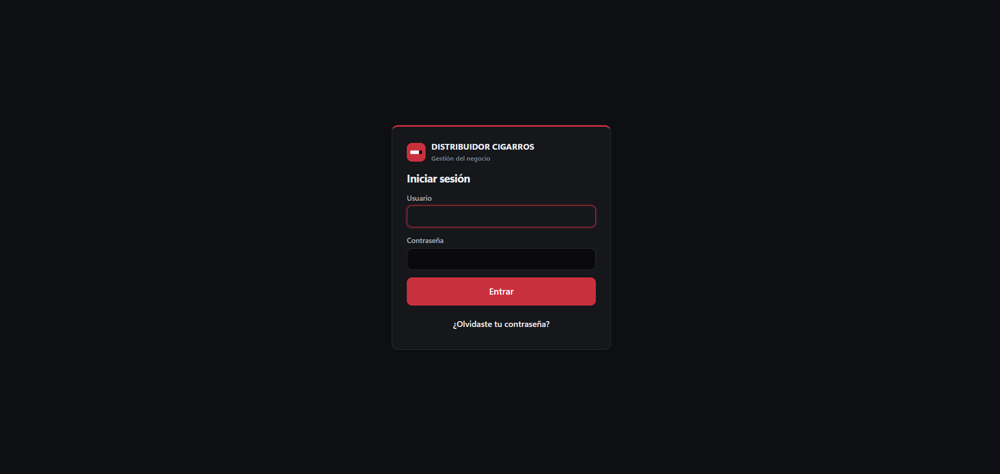

*Figura 1. Pantalla de inicio de sesión.*

### 3.1 Primera vez (configuración inicial)
La primera vez que se abre el sistema, pide crear el **administrador** (el dueño): nombre del negocio, nombre, usuario y contraseña (mínimo 8 caracteres).

### 3.2 Recuperar la contraseña
1. En el inicio de sesión tocá **"¿Olvidaste tu contraseña?"**.
2. Escribí tu usuario y tocá **"Enviarme un código"**.
3. Vas a recibir un **código de 6 números**, que vence a los 15 minutos y sirve una sola vez.
4. Escribí el código y tu contraseña nueva dos veces, y tocá **"Guardar contraseña nueva"**. Si el código venció, tocá **"Enviar otro código"**.

En esta versión el envío del código está **simulado**: el código aparece en la consola donde corre el sistema (Figura 3) o, si se inicia con `npm run start:correo`, como un correo `.eml` en la carpeta `data/bandeja-salida/`. Por seguridad, el sistema responde lo mismo exista o no el usuario.

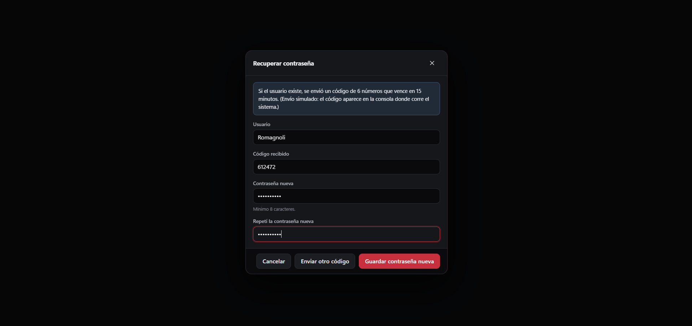

*Figura 2. Ventana "Recuperar contraseña" con el código recibido y la contraseña nueva.*

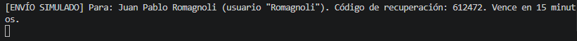

*Figura 3. Código de recuperación mostrado en la consola del sistema (envío simulado).*

## 4. Pantalla principal y menú
Arriba a la izquierda aparece el **nombre del negocio**, que se configura en **Configuración → Negocio** y también sale en el comprobante. En las figuras se ve "DISTRIBUIDOR CIGARROS", el nombre cargado en los datos de ejemplo.

A la izquierda está el menú, agrupado en **Día a día**, **Mercadería** y **Administración**. Arriba de todo está el botón **Nueva venta**. Abajo aparecen tu nombre, tu rol y **Cerrar sesión**.

El **administrador** entra a la pantalla de **Inicio** (Figura 4): accesos rápidos (Vender, Cobrar, Cargar mercadería, Ver stock), el resumen del día, los avisos de deudas vencidas y de stock bajo, y los totales del período elegido.

El **empleado** entra directamente a **Nueva venta** y ve un menú reducido (Figura 5): Ventas, Clientes, Deudas, Stock y Configuración. Las pantallas con costos, ganancias, compras y caja no le aparecen, y el servidor tampoco se las entrega aunque intente abrirlas.

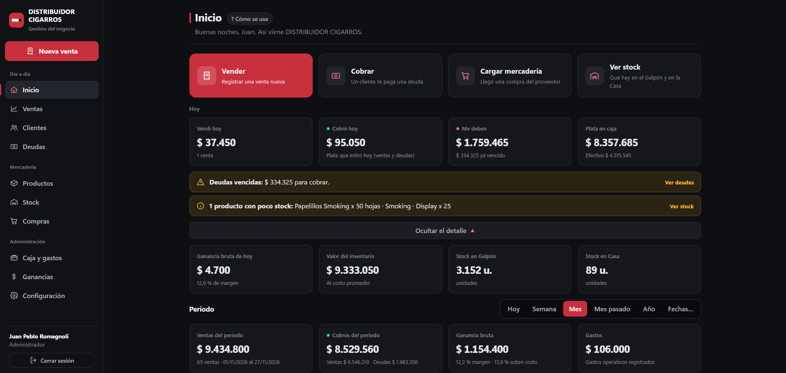

*Figura 4. Pantalla de Inicio del administrador: accesos rápidos, resumen del día, avisos y totales del período.*

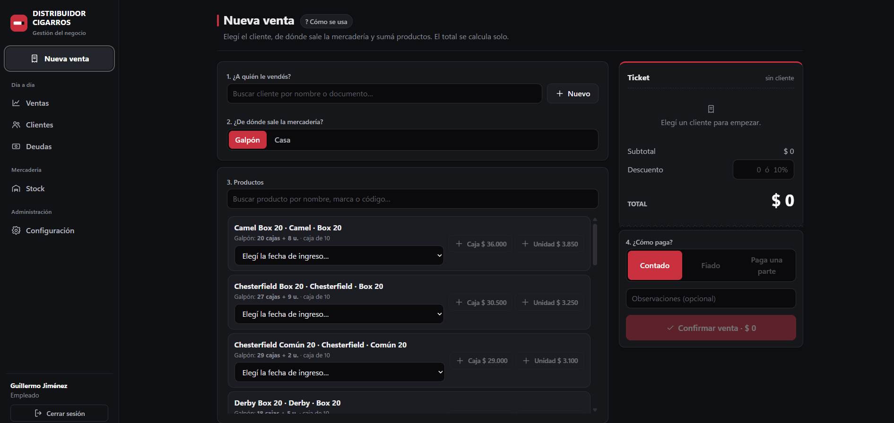

*Figura 5. Vista del Empleado: entra a Nueva venta y ve el menú reducido.*

## 5. Nueva venta
1. **¿A quién le vendés?** Buscá el cliente por nombre o documento. Si es nuevo, tocá **+ Nuevo**.
2. **¿De dónde sale la mercadería?** Elegí **Galpón** o **Casa**.
3. **Productos:** buscá el producto. Si hay mercadería de varias fechas, elegí la **fecha de ingreso** y tocá **+ Caja** o **+ Unidad**.
4. A la derecha se arma el **Ticket** con el total. Podés cargar un descuento.
5. **¿Cómo paga?** Elegí **Contado**, **Fiado** o **Paga una parte**, y el medio de pago. Si el cliente tiene deuda, en la misma operación podés registrar una **entrega para su deuda**, que se descuenta de lo más viejo primero.
6. Tocá **Confirmar venta**. Después podés imprimir o compartir el comprobante.

El sistema no deja vender más de lo que hay en el depósito, ni dejar deuda a un cliente "de contado". Si un cliente pasaría su límite de crédito, pide confirmación.

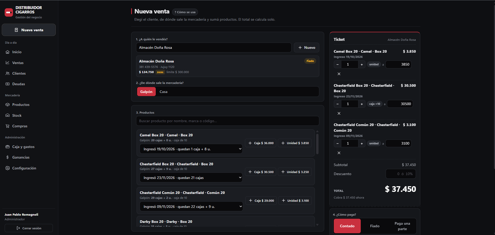

*Figura 6. Nueva venta: cliente, depósito, productos y ticket con el total.*

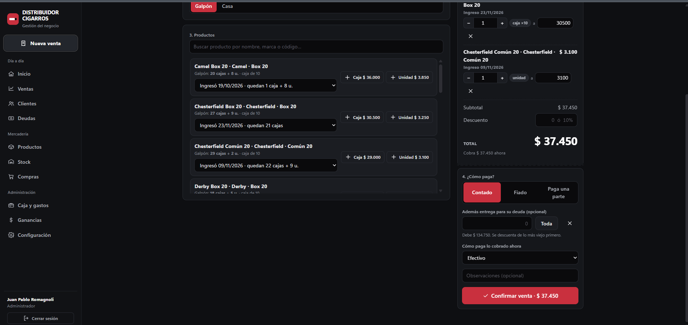

*Figura 7. Nueva venta: forma de pago, entrega para la deuda y confirmación.*

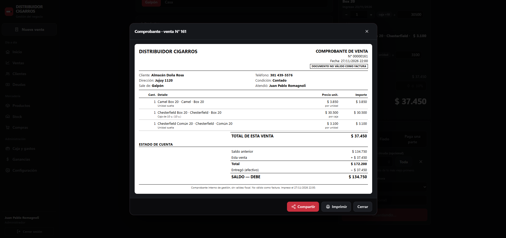

*Figura 8. Comprobante de venta con el estado de cuenta del cliente.*

## 6. Ventas
Lista de todas las ventas. Arriba:
- **Período:** Hoy, Semana, Mes, Mes pasado, Todo o Fechas…
- **Filtros:** cliente, producto, forma de pago, estado y N° de venta.
- **Limpiar filtros**, la cantidad de resultados y **Exportar** (descarga un CSV con lo filtrado).

Tocá una venta para ver el detalle, **cobrar** lo que falta, ver el comprobante o **anularla** (solo el administrador, con motivo; el stock y la deuda vuelven atrás y la venta queda como anulada).

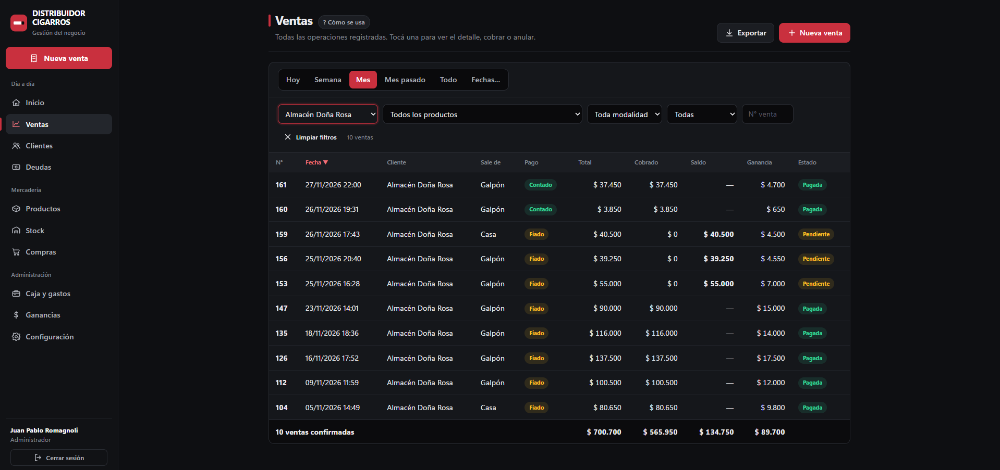

*Figura 9. Ventas del mes filtradas por cliente, con totales al pie.*

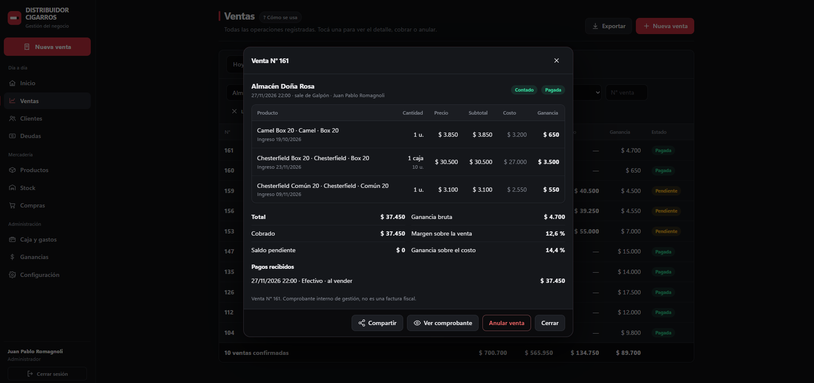

*Figura 10. Detalle de una venta con costo y ganancia (vista del administrador).*

## 7. Clientes
- **Nuevo cliente:** nombre, documento, teléfono y dirección. El administrador define además si compra de **contado o fiado**, el **límite de crédito** y el **plazo de pago**. Un cliente creado por un empleado queda "de contado".
- **Ficha del cliente:** cuánto debe, saldo a favor, total comprado, historial de ventas y cobros, y la pestaña **Lista de precios**.
- **Desactivar o eliminar:** un cliente que nunca tuvo ventas ni pagos se puede **Eliminar**; si tiene historial, se **Desactiva** y su historial se conserva *(administrador)*.
- **Precios especiales:** en la pestaña **Lista de precios** se escribe el precio propio de ese cliente por caja y por unidad, y se guarda solo al salir del casillero. Si se deja vacío, se usa el precio general. Cambiar la lista no modifica ventas anteriores. Solo el administrador los cambia (Figura 13).

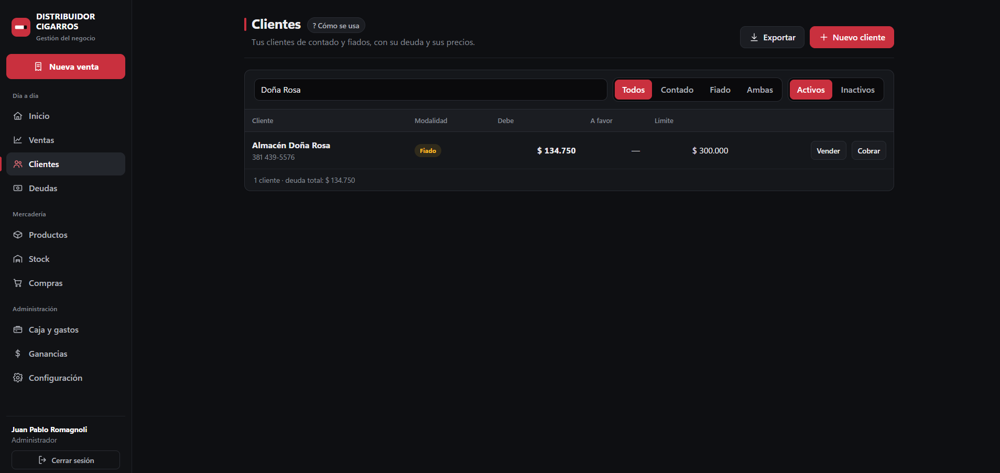

*Figura 11. Clientes: búsqueda por nombre y filtros por modalidad y estado.*

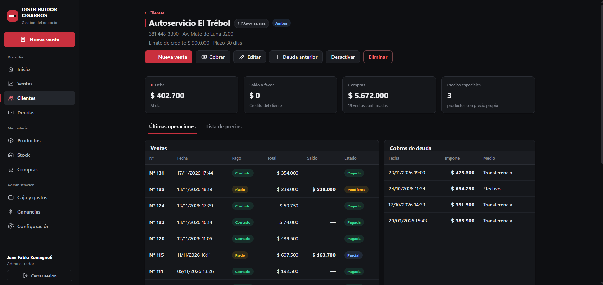

*Figura 12. Ficha del cliente: deuda, saldo a favor, compras, precios especiales y últimas operaciones.*

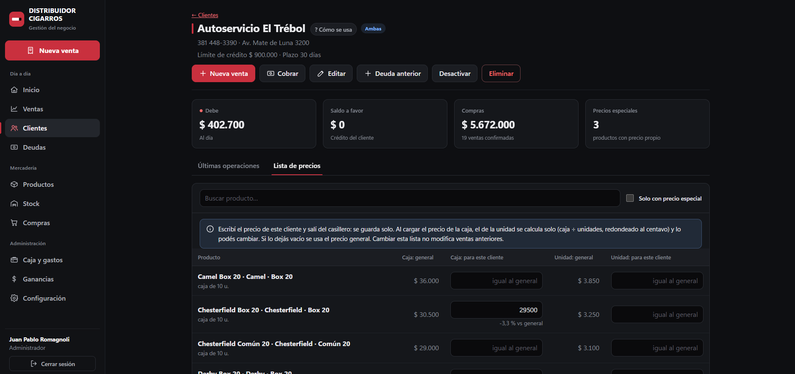

*Figura 13. Lista de precios del cliente, con un precio especial frente al precio general.*

## 8. Deudas y cobros
Tres pestañas:
- **Deudas pendientes:** cada venta con saldo, su vencimiento y estado. Se filtra por cliente y por estado (vencidas, parcialmente pagadas, sin pagos). Tiene botón **Exportar**.
- **Por cliente:** cuánto debe cada uno, con buscador.
- **Historial de cobros:** todos los cobros, con filtros por período, medio de pago y estado.

**Registrar un cobro:** tocá **Cobrar** en la fila (o **Registrar cobro** arriba), escribí el importe y el medio. El cobro se aplica a **las deudas más viejas primero**, o podés **elegir cuáles paga** venta por venta. El cobro baja la deuda y entra a la caja. Si paga de más, queda como saldo a favor.

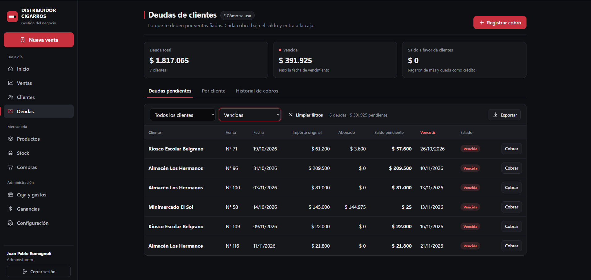

*Figura 14. Deudas pendientes filtradas por "Vencidas".*

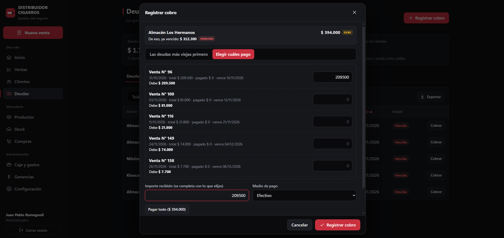

*Figura 15. Registrar cobro eligiendo qué ventas se pagan.*

## 9. Productos *(administrador)*
Alta y edición de productos: nombre, marca, variante, código, **unidades por caja**, costo, precio por caja y por unidad, y **stock mínimo**. Un producto con historial no se borra: se desactiva. Tiene buscador, filtros y **Exportar**.

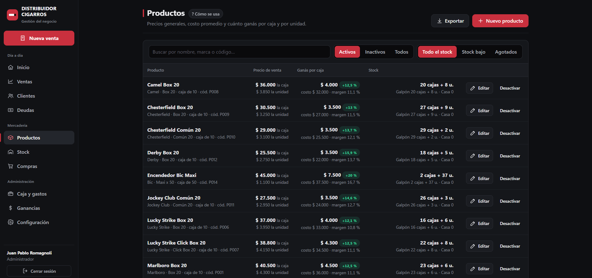

*Figura 16. Productos con precio de venta, ganancia por caja y stock por depósito.*

## 10. Stock
Muestra cuánto hay en el **Galpón** y en la **Casa**, con avisos de **stock bajo** y **agotado**. Pestañas: Existencias, Por lugar, Por fecha de ingreso, Ingresos por mes e Historial de movimientos.

El administrador además puede **Transferir** entre depósitos, cargar una **Entrada manual**, **Contar** (ajuste de inventario) y registrar una **Pérdida**, siempre con motivo. El empleado solo consulta.

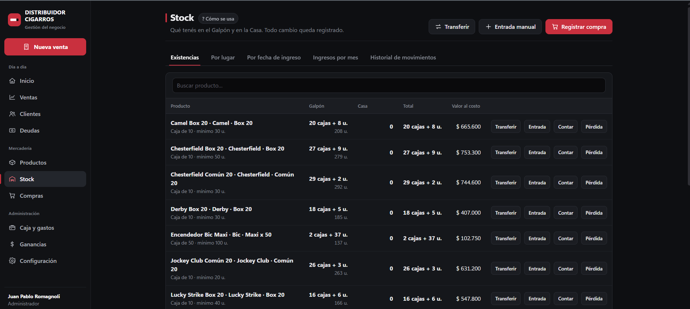

*Figura 17. Stock, pestaña Existencias, con las acciones del administrador.*

## 11. Compras y proveedores *(administrador)*
**Nueva compra:** proveedor, depósito y productos con cantidad y costo. La compra suma el stock y actualiza el costo. Si no se paga toda, queda como deuda con el proveedor.

La lista se filtra con buscador, proveedor, estado (con saldo, pagada, anulada) y período, y tiene **Exportar**. En la pestaña **Proveedores** se buscan y se ve a quiénes se les debe.

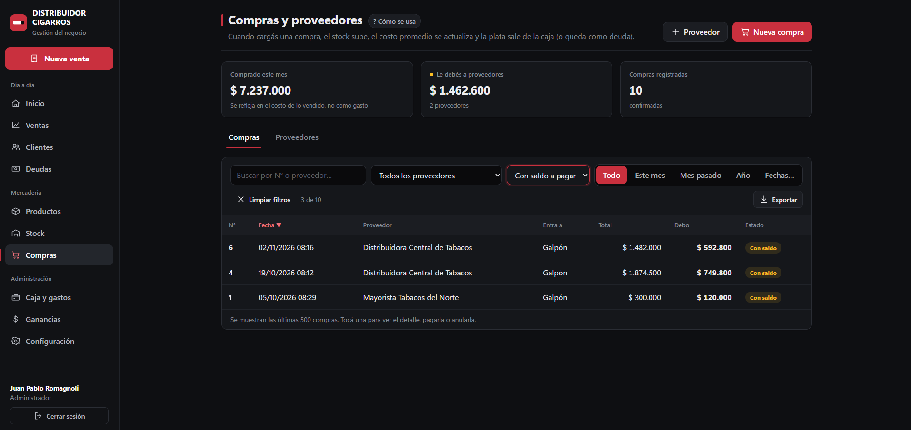

*Figura 18. Compras filtradas por "Con saldo a pagar".*

## 12. Caja y gastos *(administrador)*
Arriba muestra cuánto dinero debería haber en total y separado por medio (efectivo, transferencias y otros). Abajo, todo lo que entra y sale de la caja, con filtros por fechas, categoría y medio: ventas cobradas, cobros de deudas, pagos a proveedores, gastos y retiros. Las anulaciones no borran el movimiento original: generan uno opuesto marcado como "Corrección de un movimiento anterior". Con **Nuevo gasto** se cargan fletes, alquiler, servicios, sueldos, etc. (se descuentan de la ganancia), y con **Retiro personal** y los demás botones, los movimientos manuales de caja.

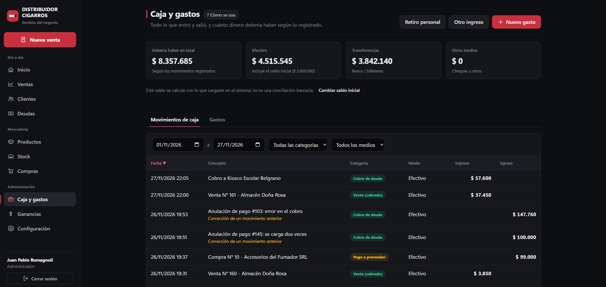

*Figura 19. Caja y gastos: saldo total y por medio de pago, y movimientos con filtros.*

## 13. Ganancias *(administrador)*
Ganancia por período (Hoy, Semana, Mes, Mes pasado, Año o Fechas…), por producto y por cliente, calculada con el costo de cada venta. Compara cada total con el período anterior y explica, paso a paso, **cómo se llega al resultado**: ventas, menos costo de lo vendido, menos gastos y pérdidas de stock.

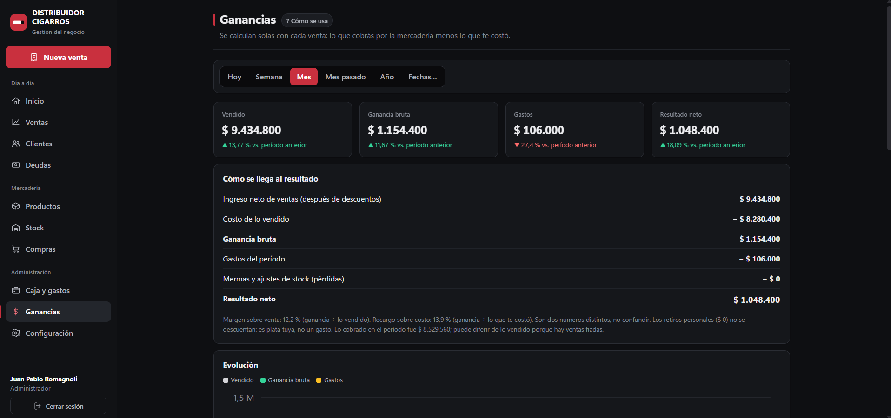

*Figura 20. Ganancias del mes y cómo se llega al resultado neto.*

## 14. Configuración
- **Mi cuenta:** ver tu usuario y **Cambiar mi contraseña** (todos los usuarios).
- **Negocio:** datos que salen en el comprobante *(administrador)*.
- **Usuarios:** **Nuevo usuario**, editar, cambiar el rol (Empleado o Administrador) o desactivar *(administrador)*. Siempre tiene que quedar al menos un administrador activo.
- **Copias de seguridad** y **Registro de actividad** *(administrador)*.

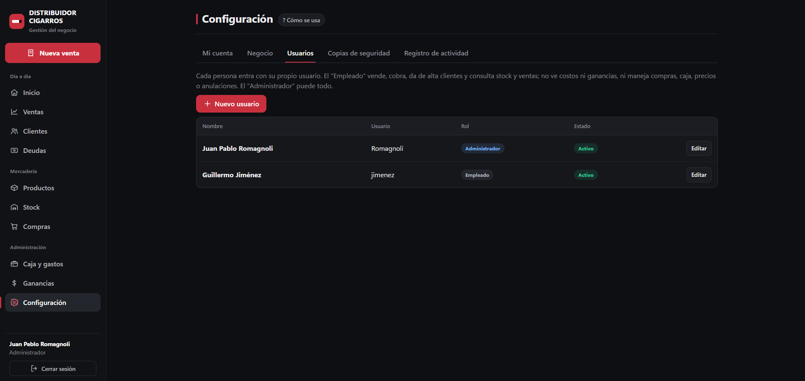

*Figura 21. Configuración → Usuarios: cada usuario con su rol y estado.*

## 15. Cerrar sesión
Tocá **Cerrar sesión** abajo a la izquierda. Si te olvidás, la sesión vence sola a los 14 días.

## 16. Preguntas frecuentes
- **Me equivoqué en una venta, ¿la borro?** No se borra: el administrador la **anula** con un motivo y el sistema devuelve el stock y corrige la deuda y la caja.
- **No me deja vender un producto.** No hay stock suficiente en ese depósito: elegí el otro depósito o cargá la compra.
- **No me deja fiarle a un cliente.** El cliente es "de contado" o pasaría su límite de crédito: lo cambia el administrador desde la ficha del cliente.
- **Olvidé la contraseña.** Usá "¿Olvidaste tu contraseña?" o pedile al administrador que te ponga una nueva.
