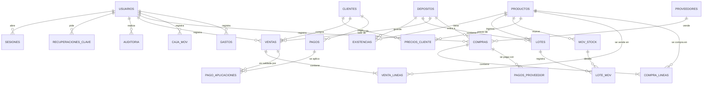

# 6. DESCRIPCIÓN DEL PROYECTO

> Todo lo descrito en esta sección está implementado en el sistema, salvo la mejora propuesta (6.11), que está planificada y presupuestada.

**Sistema:** Gestión para Distribuidoras/Negocios
**Cliente:** Gestión de Negocio de Cigarrillos
**Integrantes:** Juan Pablo Romagnoli · Guillermo Jiménez

## 6.1 Problemática detectada

El cliente, **Gestión de Negocio de Cigarrillos**, es una distribuidora mayorista de cigarrillos que vende a comercios (kioscos, almacenes) y guarda la mercadería en **dos depósitos** (galpón y casa). Antes del sistema, la gestión se hacía a mano y aparecían estos problemas:

- **Stock desconocido por depósito:** no se sabía cuánto había en cada lugar ni qué se había pasado de un depósito al otro.
- **Precios distintos por cliente:** cada comercio tiene su propio precio para algunos productos y era fácil cobrar mal.
- **Fiado y pagos parciales difíciles de seguir:** los clientes pagan de a partes y no quedaba claro cuánto debía cada uno ni qué venta estaba saldada.
- **Ganancia real desconocida:** el costo de la mercadería cambia entre compras, así que no se sabía cuánto se ganaba en cada venta.
- **Caja sin control:** se mezclaban cobros de ventas, cobros de deudas, pagos a proveedores, gastos y retiros.
- **Errores sin rastro:** cuando algo se corregía, se perdía qué había pasado y quién lo hizo.

| Elemento | Descripción |
|---|---|
| El problema | Falta de control integrado de stock en dos depósitos, precios por cliente, deudas con pagos parciales, caja y ganancias |
| Afecta a | El dueño de la distribuidora, quien vende y cobra, y los clientes (comercios) |
| Resultados actuales | Diferencias de stock, cobros con precio equivocado, deudas mal calculadas, ganancia estimada "a ojo" |
| Beneficios esperados | Stock y deudas exactos en todo momento, precio correcto para cada cliente, ganancia real por venta, caja ordenada y todo registrado |

## 6.2 Solución propuesta

Una **aplicación web cliente–servidor** que centraliza la operación del negocio:

- **Servidor** en Node.js con base de datos relacional **SQLite**; las reglas de negocio están en una capa de servicios.
- **Interfaz web** en JavaScript, usable desde la PC y desde el celular.
- **Principio central: nada se borra.** Las ventas, compras, pagos y gastos se **anulan con motivo** y queda el historial.
- **Exactitud:** el dinero se guarda en centavos enteros y el stock en unidades enteras, sin errores de redondeo.

Módulos principales:
- Usuarios, roles y seguridad.
- Productos (cajas y unidades) y stock en dos depósitos con lotes por fecha de ingreso.
- Clientes con precios propios, límite de crédito y plazo.
- Ventas al contado, fiadas o mixtas, con comprobante en PDF.
- Deudas y cobros parciales.
- Proveedores y compras con pagos.
- Caja y gastos.
- Reportes de ganancias y panel principal, con exportación a CSV.
- Copias de seguridad y auditoría.

## 6.3 Alcance del proyecto

**Incluye:**
- Login, roles Administrador / Empleado, ABM de usuarios y recuperación de contraseña (envío simulado).
- ABM y consulta de productos, clientes y proveedores (la baja es desactivación si tienen historial).
- Stock por depósito: entradas, transferencias, mermas, ajustes con motivo, lotes por fecha de ingreso y alertas de stock mínimo.
- Ventas con precio por cliente, descuentos, control de stock disponible, límite de crédito y anulación con motivo.
- Deudas calculadas (total − pagos aplicados), cobros parciales, saldo a favor y saldo inicial de clientes y proveedores.
- Compras a proveedores con costo promedio ponderado, pagos parciales y anulación.
- Caja (ingresos y egresos por categoría y medio) y gastos.
- Reportes: panel principal, ganancias por período, producto y cliente, deudas, stock bajo; exportación CSV de productos, clientes, ventas, compras y deudas; comprobante de venta en PDF.
- Auditoría de acciones y copias de seguridad.

**No incluye (límites):**
- Facturación electrónica fiscal (ARCA/AFIP). El comprobante aclara que no es factura.
- Conciliación bancaria.
- Múltiples sucursales o empresas.
- Funcionamiento sin conexión.

## 6.4 Usuarios y roles

| Rol | Quién | Puede |
|---|---|---|
| **Administrador** | El dueño | Todo: panel de inicio y ganancias, productos y precios, precios por cliente y crédito, compras y proveedores, movimientos de stock, caja y gastos, **anular** ventas, pagos y compras, saldos iniciales, usuarios, configuración, auditoría y copias de seguridad |
| **Empleado** (en la base, rol `usuario`) | Quien vende y cobra | **Vende** (con comprobante), **cobra** deudas, da de alta y corrige clientes (sin tocar su crédito) y **consulta** ventas, deudas, stock y precios. **No ve costos ni ganancias**; no maneja compras, caja, stock, precios ni anulaciones |

El control de permisos está en el servidor (`server/routes.js`): cada ruta indica si la puede usar cualquier usuario con sesión o solo el administrador, y a las consultas del empleado se les quitan los campos de costo y ganancia antes de enviarlas. La interfaz además esconde lo que el empleado no puede usar.

## 6.5 Historias de usuario

**HU1 – Iniciar sesión (Alta).** Como usuario registrado, quiero entrar con mi usuario y contraseña para acceder a las funciones de mi rol.
- Valida las credenciales; ante un error muestra un mensaje que no revela si el usuario existe.
- Después de 5 intentos fallidos bloquea el acceso por 15 minutos.

**HU2 – Recuperar contraseña (Alta).** Como usuario que olvidó su contraseña, quiero recibir un código para crear una nueva.
- Se pide con el nombre de usuario; el código tiene 6 números, vence a los 15 minutos y sirve una sola vez.
- Se bloquea tras 5 intentos fallidos; al usarlo se cierran las sesiones anteriores.

**HU3 – Gestionar usuarios (Media).** Como administrador, quiero dar de alta, modificar y desactivar usuarios con su rol, para controlar quién accede.
- No se puede dejar el sistema sin un administrador activo.

**HU4 – Registrar producto (Alta).** Como administrador, quiero cargar un producto con unidades por caja, costo, precios y stock mínimo, para venderlo por caja o por unidad.
- El código no se puede repetir. Un producto con historial no se borra, solo se desactiva.

**HU5 – Precios por cliente (Alta).** Como administrador, quiero definir el precio de un producto para un cliente en particular, para cobrarle siempre lo acordado.
- Si el cliente no tiene precio propio se usa el general. Cambiar un precio no modifica las ventas anteriores.

**HU6 – Registrar venta (Alta).** Como vendedor (administrador o empleado), quiero registrar una venta eligiendo el cliente y el depósito, para descontar el stock y registrar el cobro o la deuda.
- No permite vender más de lo disponible en el depósito.
- Puede ser al contado, fiada o mixta; la fiada respeta la modalidad y el límite de crédito del cliente.
- Genera un comprobante (también en PDF). Un doble clic no registra la venta dos veces.

**HU7 – Cobrar deuda (Alta).** Como vendedor (administrador o empleado), quiero registrar un pago parcial de un cliente, para que su deuda baje y quede el historial.
- El pago se aplica a las ventas más viejas o a las que se elijan. Lo que sobra queda como saldo a favor.

**HU8 – Registrar compra (Alta).** Como administrador, quiero registrar una compra a un proveedor, para sumar stock y actualizar el costo.
- Recalcula el costo promedio ponderado; permite dejar saldo pendiente con el proveedor.

**HU9 – Mover stock (Media).** Como administrador, quiero transferir mercadería entre depósitos y registrar mermas o ajustes con motivo, para que el stock coincida con la realidad.

**HU10 – Anular operación (Alta).** Como administrador, quiero anular una venta, pago o compra indicando el motivo, para corregir errores sin perder el historial.
- Revierte stock, deuda y caja, y queda en la auditoría.

**HU11 – Consultar reportes y exportar (Alta).** Como administrador, quiero ver ganancias, deudas y stock bajo por período y exportar listados, para tomar decisiones.
- Exporta a CSV; el comprobante de venta se descarga en PDF.

## 6.6 Reglas de negocio

**Stock**
- RN1. El stock por depósito nunca puede quedar negativo (lo impide también la base de datos).
- RN2. Todo cambio de stock genera un movimiento con tipo, depósito, usuario y motivo.
- RN3. Una transferencia entre depósitos no genera venta, cobro ni ganancia.
- RN4. Cuando el stock baja del mínimo configurado, el producto aparece en las alertas.

**Ventas y precios**
- RN5. El precio de una venta es el del cliente si lo tiene; si no, el general. El precio cobrado queda congelado en la venta.
- RN6. La ganancia de cada línea es el ingreso neto menos el costo promedio del momento de la venta.
- RN7. A un cliente "de contado" no se le puede dejar deuda; superar el límite de crédito exige confirmación.

**Deudas y pagos**
- RN8. La deuda no se guarda: se calcula como total de ventas − pagos aplicados.
- RN9. Un pago no puede aplicarse por más de lo que vale, ni una venta recibir más de su total (lo controla la base de datos).
- RN10. Cobrar una deuda cambia la caja pero no la ganancia (la ganancia se reconoce al vender).

**Anulaciones y seguridad**
- RN11. Nada se borra: ventas, compras, pagos y gastos se anulan con motivo; la anulación revierte stock, deuda y caja.
- RN12. Solo el Administrador puede anular, gestionar usuarios y ver la auditoría.
- RN13. El Empleado solo vende, cobra y consulta: no ve costos ni ganancias, y el crédito de un cliente (modalidad, límite y plazo) lo define solo el Administrador; un cliente creado por un empleado queda "de contado".
- RN14. Siempre tiene que haber al menos un Administrador activo.

## 6.7 Requisitos

### Requisitos funcionales

| Código | Descripción | Prioridad |
|---|---|---|
| RF01 | Iniciar y cerrar sesión con usuario y contraseña | Alta |
| RF02 | Recuperar la contraseña con un código de un solo uso | Alta |
| RF03 | ABM de usuarios con roles Administrador / Empleado | Alta |
| RF04 | ABM y consulta de productos | Alta |
| RF05 | ABM y consulta de clientes, con precios propios | Alta |
| RF06 | ABM y consulta de proveedores | Media |
| RF07 | Registrar entradas, transferencias, mermas y ajustes de stock por depósito | Alta |
| RF08 | Registrar ventas al contado, fiadas o mixtas con comprobante PDF | Alta |
| RF09 | Registrar cobros parciales y saldo a favor | Alta |
| RF10 | Registrar compras y pagos a proveedores | Alta |
| RF11 | Registrar movimientos de caja y gastos | Media |
| RF12 | Anular ventas, pagos y compras con motivo | Alta |
| RF13 | Ver reportes (panel, ganancias, deudas, stock bajo) y exportar a CSV | Alta |
| RF14 | Hacer y descargar copias de seguridad | Media |
| RF15 | Consultar la auditoría de acciones | Media |

### Requisitos no funcionales

| Código | Descripción |
|---|---|
| RNF01 | Aplicación web usable desde PC y celular con navegador actualizado |
| RNF02 | Base de datos relacional (SQLite) con claves primarias, foráneas, restricciones e integridad |
| RNF03 | Contraseñas guardadas con hash (scrypt); sesión con cookie HttpOnly; protección contra pedidos de otros sitios (CSRF) |
| RNF04 | Dinero en centavos enteros y stock en unidades enteras (sin errores de redondeo) |
| RNF05 | Operaciones atómicas: una venta se registra completa o no se registra |
| RNF06 | Sin dependencias externas: requiere solo Node.js ≥ 22.13 |
| RNF07 | Pruebas automáticas de punta a punta (`npm test`) |
| RNF08 | Interfaz simple: ayuda "Cómo se usa" en cada pantalla, y en todos los listados buscador, filtros, botón "Limpiar filtros" y cantidad de resultados |

## 6.8 Matriz de trazabilidad

| Historia de usuario | Reglas de negocio | Requisitos funcionales |
|---|---|---|
| HU1 Iniciar sesión | RN12 | RF01 |
| HU2 Recuperar contraseña | — | RF02 |
| HU3 Gestionar usuarios | RN12, RN13, RN14 | RF03 |
| HU4 Registrar producto | RN1, RN11 | RF04 |
| HU5 Precios por cliente | RN5 | RF05 |
| HU6 Registrar venta | RN1, RN5, RN6, RN7, RN13 | RF08 |
| HU7 Cobrar deuda | RN8, RN9, RN10 | RF09 |
| HU8 Registrar compra | RN2 | RF06, RF10 |
| HU9 Mover stock | RN1, RN2, RN3, RN4 | RF07 |
| HU10 Anular operación | RN11, RN12 | RF12, RF15 |
| HU11 Reportes y exportación | RN6, RN8 | RF11, RF13 |

## 6.9 Restricciones, limitaciones y suposiciones

**Restricciones y limitaciones**
- Una sola instancia de servidor (SQLite). Para muchos usuarios simultáneos o varias sucursales habría que migrar a PostgreSQL; el SQL está concentrado en la capa de servicios para facilitarlo.
- No emite facturas fiscales (ARCA/AFIP): el comprobante aclara que no es factura.
- Necesita conexión a la red (local o internet) para funcionar; no tiene modo sin conexión.
- La caja refleja lo registrado en el sistema; no se concilia automáticamente con el banco.
- El envío del código de recuperación de contraseña es simulado (consola o correo .eml), porque los usuarios no tienen e-mail cargado.

**Suposiciones**
- El sistema se usa en la computadora del negocio y, opcionalmente, desde celulares de la misma red.
- El administrador carga los datos iniciales: productos, clientes, proveedores y las deudas anteriores al sistema (saldo inicial).
- Los usuarios reciben una explicación inicial; cada pantalla tiene además su ayuda "Cómo se usa".
- Se hacen copias de seguridad periódicas, que el sistema facilita.

## 6.10 Diagrama Entidad–Relación y modelo relacional

El modelo tiene 23 tablas (más el registro de migraciones). Las claves foráneas están activas (`PRAGMA foreign_keys = ON`), hay restricciones `CHECK` (por ejemplo, stock ≥ 0) y triggers que impiden borrar registros financieros.

El diagrama se presenta en dos partes para que sea legible: la operación comercial (ventas, cobros y compras) y el stock con la seguridad y la caja. Productos y depósitos aparecen en ambas porque son el punto de unión.

**Modelo relacional (PK en negrita; FK indicada con →):**
- usuarios (**id**, usuario, nombre, rol, pass_hash, activo, creado)
- recuperaciones_clave (**id**, usuario_id → usuarios, codigo_hash, creada, expira, intentos, estado, cerrada)
- depositos (**id**, nombre)
- productos (**id**, codigo, nombre, marca, variante, unidades_por_caja, costo_caja, precio_unidad, precio_caja, stock_minimo, valor_inventario, activo, …)
- existencias (**producto_id → productos, deposito_id → depositos**, cantidad)
- clientes (**id**, nombre, documento, telefono, direccion, modalidad, limite_credito, plazo_dias, activo, …)
- precios_cliente (**cliente_id → clientes, producto_id → productos**, precio_unidad, precio_caja, actualizado)
- proveedores (**id**, nombre, telefono, observaciones, activo, creado)
- ventas (**id**, numero, fecha, cliente_id → clientes, deposito_id → depositos, modalidad_pago, descuento, total, estado, usuario_id → usuarios, tipo, …)
- venta_lineas (**id**, venta_id → ventas, producto_id → productos, presentacion, cantidad, unidades, precio, precio_lista, subtotal, costo_total, ganancia, …)
- pagos (**id**, cliente_id → clientes, fecha, monto, medio, origen, anulado, usuario_id → usuarios, …)
- pago_aplicaciones (**id**, pago_id → pagos, venta_id → ventas, monto, anulada, fecha)
- compras (**id**, fecha, proveedor_id → proveedores, deposito_id → depositos, total, estado, usuario_id → usuarios, tipo, …)
- compra_lineas (**id**, compra_id → compras, producto_id → productos, presentacion, cantidad, unidades, costo, costo_neto, …)
- pagos_proveedor (**id**, compra_id → compras, fecha, monto, medio, anulado, usuario_id → usuarios)
- mov_stock (**id**, fecha, producto_id → productos, tipo, unidades, deposito_origen → depositos, deposito_destino → depositos, motivo, costo, usuario_id → usuarios)
- lotes (**id**, producto_id → productos, deposito_id → depositos, fecha_ingreso, origen, unidades_iniciales, cantidad, …)
- lote_mov (**id**, lote_id → lotes, mov_id → mov_stock, unidades)
- caja_mov (**id**, fecha, tipo, categoria, medio, monto, concepto, reversa_de → caja_mov, usuario_id → usuarios)
- gastos (**id**, fecha, categoria, descripcion, monto, medio, anulado, usuario_id → usuarios)
- auditoria (**id**, fecha, usuario_id → usuarios, accion, entidad, entidad_id, detalle)
- sesiones (**token_hash**, usuario_id → usuarios, creada, expira) · config (**clave**, valor)

### Normalización (hasta 3FN)
- **1FN:** todos los campos son atómicos; no hay listas dentro de un campo. Las líneas de una venta o compra están en tablas propias (`venta_lineas`, `compra_lineas`).
- **2FN:** en las tablas con clave compuesta (`existencias`, `precios_cliente`) cada atributo depende de la clave completa: la cantidad depende del producto **y** del depósito; el precio, del cliente **y** del producto.
- **3FN:** no hay dependencias transitivas. Los datos del cliente o del producto no se repiten en las ventas: se guardan solo sus claves foráneas.
- **Datos calculables guardados a propósito** (el checklist de la cátedra pide justificarlos):
  - *Fotos históricas:* `venta_lineas.precio`, `costo_total`, `ganancia` y `ventas.saldo_anterior/posterior` guardan cómo era el dato **en ese momento**. Si se recalcularan, cambiar un precio o un costo hoy alteraría ventas pasadas.
  - *Saldos de stock:* `existencias.cantidad`, `lotes.cantidad` y `productos.valor_inventario` se actualizan en la misma transacción que cada movimiento; una prueba automática verifica que siempre coincidan con la suma de los movimientos.
  - *Lo que sí se calcula:* la **deuda** (total − pagos aplicados) no se guarda, para que nunca quede desincronizada.

**Checklist de normalización de la cátedra** (material "Normalización de Tablas"):

| Pregunta | Respuesta en el modelo |
|---|---|
| ¿Cada campo tiene un único valor? (1FN) | Sí. No hay listas en un campo: los productos de una venta o compra están en tablas de detalle. |
| ¿Hay campos no clave que dependan solo de parte de la PK? (2FN) | No. En `existencias` y `precios_cliente` (claves compuestas) los atributos dependen de la clave completa. |
| ¿Hay campos que dependen de otros campos no clave? (3FN) | No. Nombre, dirección o precio general del cliente y del producto no se copian en otras tablas; se referencian por su clave. |
| ¿Hay redundancia evidente? | No. Los únicos valores repetidos son fotos históricas justificadas (precio y costo al momento de la venta). |
| ¿Se podría perder información si elimino una fila? | No. Los registros financieros y de stock no se borran (lo impiden triggers): se anulan con motivo. |
| ¿Hay datos calculables guardados innecesariamente? | La deuda no se guarda. Los saldos de stock sí, por rendimiento, y una prueba automática verifica que coincidan con los movimientos. |
| ¿Cada tabla representa una sola entidad conceptual? | Sí (ver el diccionario de datos en el Anexo B). |

## 6.11 Propuesta de mejora y presupuesto

**Mejora propuesta: exportación a PDF de los reportes de ganancias, deudas y caja.** Hoy esos reportes se ven en pantalla y algunos listados salen en CSV, pero el dueño necesita imprimirlos o enviarlos. Reutiliza el generador de PDF que ya existe en el sistema.

| Concepto | Horas | Valor hora | Subtotal |
|---|---|---|---|
| **Costo del sistema original** (sprints 1 y 2) | 70 hs | $ 6.000 | **$ 420.000** |
| Adecuación al TFI: recuperación de contraseña, roles, filtros, patrón Strategy, documentación y manual (sprint 3) | 20 hs | $ 6.000 | $ 120.000 |
| **Costo de la ampliación** (mejora: reportes en PDF) | 5 hs | $ 6.000 | **$ 30.000** |
| **Presupuesto total del sistema con la mejora** | **95 hs** | | **$ 570.000** |

**Valor hora:** $ 6.000, tomado como el límite entre programador *junior* ($ 3.000–6.000) y *semi-senior* ($ 6.000–12.000) según la referencia de mercado de Hacé Cuentas (2026) para Argentina. Se eligió ese valor porque el equipo está formado por estudiantes avanzados que desarrollaron un sistema completo. No existe un arancel oficial de referencia para programadores; el valor se puede ajustar sin cambiar las horas.

**Detalle de la ampliación (5 hs):** botón "Exportar PDF" en Ganancias, Deudas y Caja (2 hs), armado del documento con el generador de PDF que ya tiene el sistema (2 hs) y pruebas automáticas (1 h).

## 6.12 Mejoras a futuro
- Envío real del código de recuperación por correo (SMTP) o WhatsApp: se agrega como un canal nuevo del patrón Strategy, sin tocar la lógica de seguridad.
- Cobro de deudas con Mercado Pago (link o QR de pago), siguiendo el instructivo de integración (Checkout Pro y webhook) que brinda la cátedra; la conexión con el SDK externo se aislaría con el patrón Adapter.
- Que la venta proponga automáticamente la fecha de ingreso más antigua (lo primero que entra, primero sale), para agilizar la carga.
- Avisos automáticos de deuda vencida.
- Importación de productos desde Excel.
- Pedido de reposición automático según stock mínimo.
- Facturación electrónica (ARCA/AFIP).

## 6.13 Atributos de calidad del sistema

| Atributo | Cómo se cumple |
|---|---|
| Seguridad | Contraseñas con hash (scrypt), bloqueo tras 5 intentos, sesión con cookie HttpOnly, protección CSRF, permisos por rol controlados en el servidor |
| Fiabilidad | Operaciones atómicas (todo o nada), restricciones en la base, copias de seguridad y 58 pruebas automáticas |
| Exactitud | Dinero en centavos enteros y stock en unidades enteras; prueba de integridad contable global |
| Usabilidad | Ayuda "Cómo se usa" en cada pantalla, filtros, buscadores y mensajes claros en español |
| Mantenibilidad | Arquitectura en capas, código modular con componentes reutilizables, migraciones de base de datos y decisiones documentadas |
| Portabilidad | Funciona en cualquier sistema con Node.js 22.13 o superior y un navegador; se usa desde PC y celular |
| Trazabilidad | Nada se borra: anulaciones con motivo y registro de auditoría con usuario y fecha |

## 6.14 Criterios de aceptación del sistema
- Una venta descuenta el stock del depósito elegido y nunca deja stock negativo.
- La deuda de un cliente es igual a sus ventas menos los pagos aplicados, también después de anular operaciones.
- El saldo de caja coincide con la suma de sus movimientos.
- Cada rol accede solo a lo que le corresponde, incluso llamando directamente a la API.
- Los datos persisten después de reiniciar el sistema.
- `npm test` termina con todas las pruebas aprobadas (58/58).
