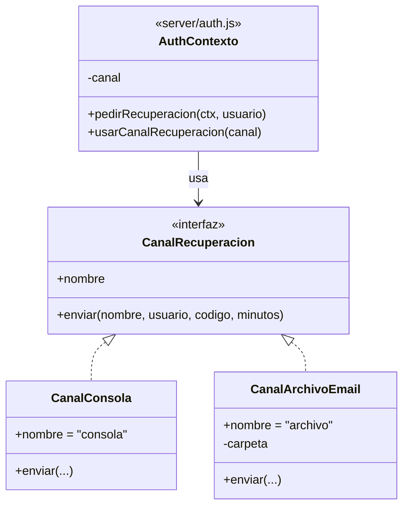

# TP – Patrón de diseño: Strategy

**Proyecto:** Gestión para Distribuidoras/Negocios (cliente: Gestión de Negocio de Cigarrillos)
**Integrantes:** Juan Pablo Romagnoli · Guillermo Jiménez
**Fecha:** 26/11/2026

## 1. Problema identificado

El sistema permite **recuperar la contraseña** con un código de 6 números (requisito del TFI: "mecanismo de recuperación, real o simulado"). Antes de este TP, el envío del código estaba escrito **dentro** de la lógica de seguridad (`server/auth.js`), fijo a un único medio: se imprimía en la consola del servidor.

```js
// Antes: auth.js sabía QUÉ enviar y también CÓMO enviarlo (un solo medio, fijo)
function enviarCodigo(u, codigo) {
  console.log(`[ENVÍO SIMULADO] ... Código de recuperación: ${codigo} ...`);
}
```

Problemas concretos:
1. **Cambiar el medio de envío obliga a tocar código de seguridad.** Para mandar el código por correo o por WhatsApp habría que modificar `auth.js`, que también genera el código, lo guarda hasheado, controla el vencimiento, los intentos y el límite de pedidos. Un error ahí compromete el acceso al sistema.
2. **El medio puede variar según el negocio y el momento** (consola en la demo, correo en producción, WhatsApp a futuro), y no había forma de elegirlo sin reescribir código.
3. **No se podía probar cada medio por separado** de la lógica de recuperación.

## 2. Patrón elegido: Strategy (familia "De Comportamiento")

> **Strategy – Algoritmos intercambiables** (Unidad 4): encapsula algoritmos en clases independientes detrás de una interfaz común. Reemplaza los bloques if/else y permite agregar nuevas reglas sin tocar ni romper el código original (principio Open/Closed).

**Diagnóstico** según la *Matriz de Diagnóstico del Arquitecto* de la unidad:

| Problema (diagnóstico) | Solución sugerida |
|---|---|
| "Tengo varias formas alternativas de [hacer] algo y quiero intercambiarlas…" | **Strategy** |

En el problema hay **una tarea fija** (enviar un código a un usuario) con **varias formas de hacerla** (por consola o por correo) que se tienen que poder **intercambiar sin tocar a quien la usa**. Como en el ejemplo de la unidad de la `CalculadoraCuota`, que "no sabe cómo se calcula, solo recibe el cartucho correcto", acá `auth.js` no sabe cómo se envía el código: recibe el canal elegido y llama a la interfaz común `enviar()`.

**Arquitectura y patrón no son lo mismo** (Unidad 4: "lo macro y lo micro"). El sistema ya tiene una arquitectura en capas (presentación, lógica de negocio, datos). Strategy es una decisión *micro*, dentro de la capa de lógica, para un problema puntual.

### Cómo se mapea al proyecto

| Rol del patrón | En el proyecto |
|---|---|
| **Contexto** | `server/auth.js` → `pedirRecuperacion()`: sabe *qué* y *cuándo* enviar (genera el código, lo guarda hasheado, aplica límites), pero **no cómo** |
| **Estrategia** (interfaz) | Todo canal tiene `nombre` y `enviar({ nombre, usuario, codigo, minutos })` |
| **Estrategia concreta 1** | `CanalConsola`: escribe el aviso en la consola del servidor (envío simulado, el de la demo) |
| **Estrategia concreta 2** | `CanalArchivoEmail`: genera un **correo real en formato .eml** (estándar RFC 5322) en `data/bandeja-salida/`; se abre con doble clic en Outlook o el Correo de Windows |
| **Elección de la estrategia** | `crearCanal(nombre)`, según la configuración `CANAL_RECUPERACION` al arrancar (`consola` por defecto, o `archivo`) |



```js
// Después: auth.js solo le pide al canal elegido que envíe
let canal = crearCanal(process.env.CANAL_RECUPERACION || 'consola', { carpeta: ... });
function enviarCodigo(u, codigo) {
  canal.enviar({ nombre: u.nombre, usuario: u.usuario, codigo, minutos: 15 });
}
```

## 3. Por qué Strategy y no otro patrón del catálogo

Se compara contra todo el catálogo de la Unidad 4, usando la pregunta de cada familia: **creacionales** (cómo nacen los objetos), **estructurales** (cómo se ensamblan) y **de comportamiento** (cómo se comunican y reparten responsabilidades).

| Patrón (familia) | ¿Resuelve el problema? | Motivo |
|---|---|---|
| **Strategy** (comportamiento) ✅ | **Sí** | El problema es **intercambiar formas alternativas de hacer lo mismo** (enviar el código) sin tocar a quien lo usa. Es exactamente su diagnóstico. |
| Factory Method (creacional) | No, solo | Resuelve **cómo se crea** un objeto según un dato de entrada, no cómo varía lo que hace. Lo usamos como **complemento**: `crearCanal(nombre)` es el punto único de decisión que crea la estrategia según la configuración. Sin Strategy, la fábrica no tendría una interfaz común que devolver. |
| Builder (creacional) | No | Sirve para armar un objeto con **muchos parámetros opcionales**. Un canal se crea con un solo dato (la carpeta); no hay "constructor gigante". |
| Singleton (creacional) | No | Garantiza **una única instancia global**. La unidad advierte que introduce acoplamiento oculto y dificulta las pruebas; además, acá necesitamos poder **cambiar** el canal, no fijar uno solo. |
| Adapter (estructural) | No (hoy) | Sirve para **conectar código propio con un SDK externo** de interfaz distinta. Hoy no hay ningún servicio externo. Si mañana se usa la API de WhatsApp, un Adapter podría ir *dentro* de esa estrategia concreta. |
| Facade (estructural) | No | Oculta la **coordinación de varios módulos** detrás de un punto de entrada simple. Acá no se orquestan varios módulos: se elige **una** forma de enviar. |
| Decorator (estructural) | No | Sirve para **combinar comportamientos opcionales en capas** (descuento + recargo). Acá los canales **no se combinan**: se usa uno u otro. |
| Observer (comportamiento) | No | Sirve para que **un evento dispare varias reacciones desacopladas**. Acá un pedido produce **un** envío por **un** canal elegido, no avisos a varios interesados. |
| Command (comportamiento) | No | Convierte una **acción en objeto** para encolarla, registrarla o deshacerla. No se necesita deshacer ni encolar envíos. |
| State (comportamiento) | No | Cambia el comportamiento de un objeto **según su estado interno** (pendiente → usada → bloqueada). El pedido de recuperación tiene estados, pero se manejan con una sola regla simple en la base; lo que varía según la **configuración** es el medio de envío, y eso es Strategy. |

**Criterio usado:** el de la Unidad 4 (*primero el problema, después el patrón*; *costo justificado*) y el de los requisitos técnicos del TFI (*separación de responsabilidades, modularidad y reutilización, robustez*).

### Patrones = SOLID en acción

| Principio | Cómo lo cumple el diseño |
|---|---|
| **O – Open/Closed** | Para sumar un canal (SMTP, WhatsApp) se agrega una clase con `enviar()` y una línea en `CANALES`; `auth.js` no se modifica. |
| **S – Single Responsibility** | `auth.js` se ocupa solo de la seguridad (generar, guardar hasheado, vencer, limitar). Cada canal se ocupa solo de enviar. |
| **D – Dependency Inversion** | `auth.js` depende de la **abstracción** (algo con `enviar()`), no de una clase concreta: se le puede pasar cualquier canal (`usarCanalRecuperacion`). |

Además:
- **Robustez:** si el canal falla, el sistema lo informa ("No se pudo enviar el código…") en vez de fingir que salió.
- **Pruebas aisladas:** cada canal se prueba por separado, y el sistema completo se prueba con el canal cambiado.

## 3 bis. Costo arquitectónico y consecuencias (trade-off)

> Unidad 4: **Problema Real Identificado + Costo Arquitectónico Justificado = Patrón Exitoso.**

**Costo de aplicar Strategy:**
- Un archivo más (`canales-recuperacion.js`) y una **indirección**: para saber cómo se envía el código hay que mirar el canal configurado, no `auth.js`.
- Una configuración más que conocer (`CANAL_RECUPERACION`).

**Por qué el costo está justificado y no es sobreingeniería (YAGNI):**
- **El problema es real y existe hoy:** el sistema ya tiene **dos** formas de enviar el código y las dos funcionan (`npm start` por consola; `npm run start:correo` por correo .eml). No se aplicó el patrón "por las dudas".
- **No se agregaron canales imaginarios.** Correo por SMTP y WhatsApp quedan como trabajo futuro (sección 6) y **no** están programados, justamente para no crear complejidad para un futuro que tal vez no llegue.
- **El costo es chico:** dos clases cortas y una función que elige, frente a la alternativa de meter `if/else` por canal dentro de la lógica de seguridad.
- **Se mantuvo lo simple donde alcanza:** los estados del pedido (pendiente, usada, bloqueada) **no** se resolvieron con un patrón, porque una regla simple en la base los resuelve.

## 4. Implementación (código funcional)

| Archivo | Qué hay |
|---|---|
| `server/notificaciones/canales-recuperacion.js` | **Nuevo.** Interfaz documentada, `CanalConsola`, `CanalArchivoEmail`, `crearCanal()` |
| `server/auth.js` | El contexto: usa `canal.enviar(...)`; `usarCanalRecuperacion()` permite reemplazar la estrategia |
| `server/index.js` | Al arrancar muestra qué canal está en uso |
| `package.json` | `npm start` (canal consola) y `npm run start:correo` (canal archivo) |
| `tests/run.js` | 2 pruebas automáticas nuevas del patrón |

## 5. Cómo verificarlo

1. **Pruebas automáticas:** `npm test` → **58/58 OK**. Dos de ellas son del patrón:
   - *"cada canal de recuperación funciona solo y un canal desconocido es un error"*: prueba las dos estrategias por separado con la misma interfaz.
   - *"con CANAL_RECUPERACION=archivo el código llega como correo .eml y sirve"*: levanta el sistema con el otro canal, pide el código, lo lee del correo generado, cambia la contraseña e inicia sesión. El código de `auth.js` es el mismo; solo cambió la estrategia.
2. **A mano, canal consola:** `npm start` → en el login, "¿Olvidaste tu contraseña?" → el código aparece en la terminal.
3. **A mano, canal archivo:** `npm run start:correo` → pedir el código → en la carpeta `data/bandeja-salida/` aparece `recuperacion-<usuario>-<fecha>.eml` → doble clic para abrirlo como un correo → usar el código.

## 6. Límites y trabajo futuro
- El canal "archivo" **no envía por Internet**: deja el correo listo en una bandeja de salida. El paso siguiente es una estrategia `CanalSmtp` que lo mande por un servidor de correo, con el mismo contenido.
- Los usuarios del sistema hoy no tienen e-mail cargado; para un envío real habría que agregar ese dato (migración nueva).
- La bandeja de salida contiene códigos vigentes: está dentro de `data/`, que no se sube al repositorio.
