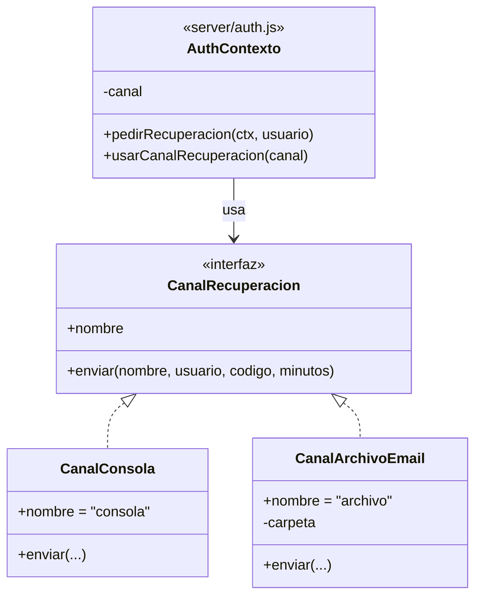

# TP – Patrón de diseño: Strategy

**Proyecto:** Gestión para Distribuidoras/Negocios (cliente: Gestión de Negocio de Cigarrillos)
**Integrantes:** Juan Pablo Romagnoli · Guillermo Jiménez
**Fecha:** 26/11/2026

## 1. Problema identificado

El sistema permite **recuperar la contraseña** con un código de 6 números (requisito del TFI: "mecanismo de recuperación, real o simulado"). Antes de este TP, el envío del código estaba escrito **dentro** de la lógica de seguridad (`server/auth.js`), fijo a un único medio: se imprimía en la consola del servidor.

```js
// Antes: auth.js sabía QUÉ enviar y también CÓMO enviarlo (un solo medio, fijo)
function enviarCodigo(u, codigo) {
  console.log(`[ENVÍO SIMULADO] ... Código de recuperación: ${codigo} ...`);
}
```

Problemas concretos:
1. **Cambiar el medio de envío obliga a tocar código de seguridad.** Para mandar el código por correo o por WhatsApp habría que modificar `auth.js`, que también genera el código, lo guarda hasheado, controla el vencimiento, los intentos y el límite de pedidos. Un error ahí compromete el acceso al sistema.
2. **El medio puede variar según el negocio y el momento** (consola en la demo, correo en producción, WhatsApp a futuro), y no había forma de elegirlo sin reescribir código.
3. **No se podía probar cada medio por separado** de la lógica de recuperación.

## 2. Patrón elegido: Strategy (comportamiento, GoF)

> Strategy define una familia de algoritmos, encapsula cada uno y los hace intercambiables. Permite que el algoritmo varíe independientemente de los clientes que lo usan.

En el problema hay **una tarea fija** (enviar un código a un usuario) con **varias formas de hacerla** que se tienen que poder **intercambiar sin tocar a quien la usa**. Esa es exactamente la situación que resuelve Strategy.

### Cómo se mapea al proyecto

| Rol del patrón | En el proyecto |
|---|---|
| **Contexto** | `server/auth.js` → `pedirRecuperacion()`: sabe *qué* y *cuándo* enviar (genera el código, lo guarda hasheado, aplica límites), pero **no cómo** |
| **Estrategia** (interfaz) | Todo canal tiene `nombre` y `enviar({ nombre, usuario, codigo, minutos })` |
| **Estrategia concreta 1** | `CanalConsola`: escribe el aviso en la consola del servidor (envío simulado, el de la demo) |
| **Estrategia concreta 2** | `CanalArchivoEmail`: genera un **correo real en formato .eml** (estándar RFC 5322) en `data/bandeja-salida/`; se abre con doble clic en Outlook o el Correo de Windows |
| **Elección de la estrategia** | `crearCanal(nombre)`, según la configuración `CANAL_RECUPERACION` al arrancar (`consola` por defecto, o `archivo`) |



```js
// Después: auth.js solo le pide al canal elegido que envíe
let canal = crearCanal(process.env.CANAL_RECUPERACION || 'consola', { carpeta: ... });
function enviarCodigo(u, codigo) {
  canal.enviar({ nombre: u.nombre, usuario: u.usuario, codigo, minutos: 15 });
}
```

## 3. Por qué Strategy y no otro patrón

| Patrón | ¿Resuelve el problema? | Motivo |
|---|---|---|
| **Strategy** ✅ | Sí | El problema es **variar un comportamiento** (cómo se envía) e **intercambiarlo** sin tocar al que lo usa. Es su definición. |
| Factory Method / Simple Factory | No, solo | Resuelve **cómo se crea** un objeto, no cómo variar lo que hace. Lo usamos como complemento (`crearCanal`) para elegir la estrategia por configuración, pero por sí solo deja el problema igual. |
| Template Method | No | Fija un algoritmo en una clase base y deja variar pasos por **herencia**. Acá no hay pasos comunes que reutilizar entre canales, y obligaría a heredar de una clase base de `auth`, mezclando otra vez seguridad con envío. |
| Adapter | No | Sirve para **adaptar una interfaz existente** que no encaja (por ejemplo, una librería externa). Hoy no hay ninguna interfaz externa que adaptar. Si mañana se usa la API de WhatsApp, un Adapter podría ir *dentro* de esa estrategia concreta. |
| Observer | No | Sirve para avisar a **muchos** interesados cuando algo cambia. Acá se elige **un** medio de envío, no se notifica a varios. |
| Singleton | No | Garantiza una única instancia; no ayuda a intercambiar comportamientos. |

**Criterio usado** (el mismo de los requisitos técnicos del TFI): *separación de responsabilidades*, *modularidad y reutilización*, y *robustez*. Con Strategy:
- **Separación de responsabilidades:** `auth.js` decide la seguridad; cada canal decide el envío.
- **Abierto/cerrado:** para sumar un canal (correo por SMTP, WhatsApp) se agrega una clase con `enviar()` y una línea en `CANALES`. `auth.js` no se modifica.
- **Robustez:** si el canal falla, el sistema lo informa ("No se pudo enviar el código…") en vez de fingir que salió.
- **Pruebas:** cada canal se prueba solo, y el sistema completo se prueba con el canal cambiado.

## 4. Implementación (código funcional)

| Archivo | Qué hay |
|---|---|
| `server/notificaciones/canales-recuperacion.js` | **Nuevo.** Interfaz documentada, `CanalConsola`, `CanalArchivoEmail`, `crearCanal()` |
| `server/auth.js` | El contexto: usa `canal.enviar(...)`; `usarCanalRecuperacion()` permite reemplazar la estrategia |
| `server/index.js` | Al arrancar muestra qué canal está en uso |
| `package.json` | `npm start` (canal consola) y `npm run start:correo` (canal archivo) |
| `tests/run.js` | 2 pruebas automáticas nuevas del patrón |

## 5. Cómo verificarlo

1. **Pruebas automáticas:** `npm test` → **58/58 OK**. Dos de ellas son del patrón:
   - *"cada canal de recuperación funciona solo y un canal desconocido es un error"*: prueba las dos estrategias por separado con la misma interfaz.
   - *"con CANAL_RECUPERACION=archivo el código llega como correo .eml y sirve"*: levanta el sistema con el otro canal, pide el código, lo lee del correo generado, cambia la contraseña e inicia sesión. El código de `auth.js` es el mismo; solo cambió la estrategia.
2. **A mano, canal consola:** `npm start` → en el login, "¿Olvidaste tu contraseña?" → el código aparece en la terminal.
3. **A mano, canal archivo:** `npm run start:correo` → pedir el código → en la carpeta `data/bandeja-salida/` aparece `recuperacion-<usuario>-<fecha>.eml` → doble clic para abrirlo como un correo → usar el código.

## 6. Límites y trabajo futuro
- El canal "archivo" **no envía por Internet**: deja el correo listo en una bandeja de salida. El paso siguiente es una estrategia `CanalSmtp` que lo mande por un servidor de correo, con el mismo contenido.
- Los usuarios del sistema hoy no tienen e-mail cargado; para un envío real habría que agregar ese dato (migración nueva).
- La bandeja de salida contiene códigos vigentes: está dentro de `data/`, que no se sube al repositorio.
